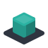
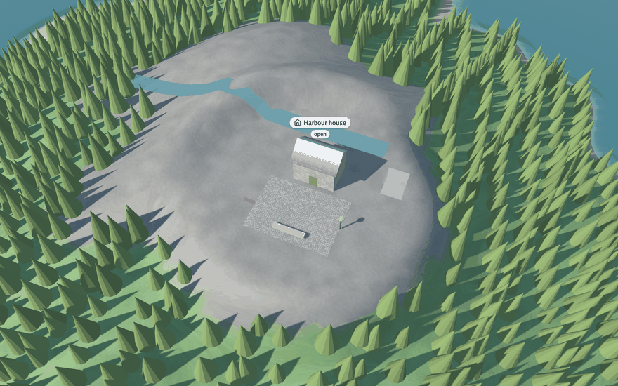
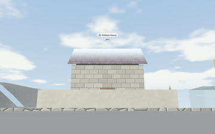
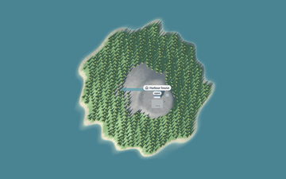
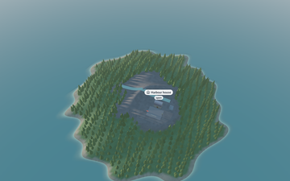
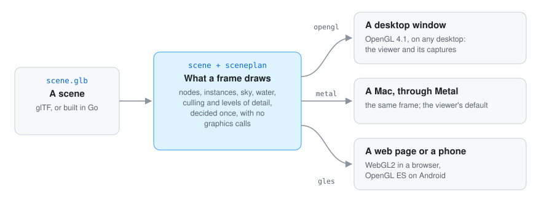

<p align="center"></p>

<div align="center">

# Go renderer

**A tiny, educational graphics renderer built in Go.** It explores graphics pipelines from scratch
behind a clean, simple API: draw shapes every frame, or load a whole glTF scene (terrain, forests,
towns, sea and sky) and explore it in a viewer, on the desktop, in a web page or on a phone.

[](go.mod)


[](LICENSE)

</div>

> **Note:** parts of this project (the scene renderer, the viewer and the docs) were written with an AI assistant and are pending thorough review. See the [AI disclosure](#-ai-disclosure).

> ⚠️ **Warning:** This software is an educational experiment and is **not suitable for production
> use**. APIs will break and errors are likely.

## 🤖 AI disclosure

I write most of my code by hand, so I want to be clear about where AI was used here.

- **Hand-written (May 2026):** the immediate-mode `Renderer` contract, the `software`, `vulkan`,
  `metal` and `webgpu` backends, the `graphics` maths and the first OpenGL work.
- **Written by an AI assistant (Claude, by Anthropic) under my direction, since September 2026:**
  the retained scene (`scene`), the glTF loader, the OpenGL scene renderer (sky, shadows, water,
  instancing, levels of detail, the overlay of labels and notices with its font and icon atlas in
  `opengl/overlay`, and the 2D draw lists of `draw2d` it paints), `camera`, `input`, `viewer`,
  `cmd/visor` and the documentation in `docs/`. It also extended `graphics`, `loaders` and the
  first `models` package.
  Since October 2026 it also wrote the shared window loop (`windowloop`), the frame planning both
  scene renderers share (`internal/sceneplan`), the sample island (`scene/sample`) and the Metal renderers
  in `metal/` (flat and 3D: `FlatWindow`, `FlatRenderer`, `SceneWindow`, `SceneRenderer`, the
  Objective-C files and the translated shaders), next to my hand-written `metal` stubs, which it
  left as they were. It also wrote the first step towards browsers and phones: the OpenGL ES
  renderers (`gles`), the browser canvas and loop (`browser`), the Android activity and loop
  (`android`, with its C), the shared clock (`frameloop`) and `cmd/web-island`, and later the
  screen reader's side on Android (`android/screenreader*`, with the Java class in `android/java`),
  and the first drawing on the Nintendo 3DS (`nintendo3ds`, with its C, and `cmd/triangle3ds`).
- **My hand-written parts, refactored by the AI at my request (2026-10-22):** the `Renderer`
  contract and `models` (split into `immediate`, `window` and `camera.Lens`), the `graphics`
  maths (`Vec4`/`Mat4` became `Vector`/`Matrix`), the first OpenGL work (`opengl.Window`,
  `opengl.Renderer`), `loaders.LoadModel`, the root `main.go` and the stubs: whole-word names,
  comments, coded errors instead of panics and prints. This refactoring is pending my review.

Commits made with AI carry a `Co-Authored-By: Claude` line.

**Status: pending thorough review.** The code compiles and its tests pass, but I have not yet
reviewed it line by line. Treat it as a working draft, not as code I vouch for.

---

<p align="center">
<picture>
  <source media="(prefers-color-scheme: dark)" srcset="docs/images/hero-dark.png">
  
</picture>
</p>

## ✨ What it looks like

<table>
<tr>
<th width="33%">Walking on the ground</th>
<th width="33%">A map without perspective</th>
<th width="33%">The sun at any hour</th>
</tr>
<tr>
<td>
<picture>
  <source media="(prefers-color-scheme: dark)" srcset="docs/images/walk-dark.png">
  
</picture>
</td>
<td></td>
<td></td>
</tr>
<tr>
<td>Eye height, the sky with clouds, the moon and the stars; labels follow what they name.</td>
<td>From straight above or at the isometric angle, so lengths can be compared anywhere.</td>
<td>Shadows from the sun, fog, a sea that fades into the shore, and night under the moon.</td>
</tr>
<tr>
<td colspan="3" align="center">All of it is the built-in, made-up sample island (<code>-sample island</code>), captured with <code>cmd/visor -capture</code>.</td>
</tr>
</table>

## 🚀 Quick start

```bash
go run ./cmd/visor scene.glb          # explore a scene: drag to orbit, Tab to walk, M for a 2D map
go run ./cmd/visor -walk -night scene.glb
go run ./cmd/visor -sample island         # a built-in made-up island
go run ./cmd/visor -sample island -capture frame.png   # one frame to a PNG, in a hidden window
```

It needs a display with OpenGL 4.1 (or Metal on macOS), and the OpenGL, X11/Wayland and GLFW
build headers, since the window goes through GLFW and cgo. Every control and option is in
[the viewer](docs/4-guides/2-viewer.md).

## 🔍 How it works

<p align="center">
  
</p>

What a frame draws (culling, levels of detail, instance batches, shadows, sky, water, the overlay)
is decided once, in plain Go; each backend only uploads and draws that plan. Next to it sits the
original, hand-written immediate-mode contract, where a program says "draw this triangle" every
frame. [More on the architecture →](docs/4-guides/1-architecture.md)

## 🎯 Goals

* **Understand the pipeline:** vertex processing, clipping, rasterization and fragment shading.
* **Clean abstraction:** an idiomatic Go API that hides backend complexity from the application.
* **Minimal dependencies:** core maths and rendering concepts built by hand, to understand them.

## 📚 Documentation

New here? Start with the [overview](docs/1-overview.md), then [get started](docs/2-get-started.md) and [the quest](docs/3-the-quest/0-the-quest.md). Every package is in [the reference](docs/5-reference/0-packages.md).

| | |
|---|---|
| [Architecture](docs/4-guides/1-architecture.md) | The two ways to draw, the packages, the retained scene, the passes of a frame. |
| [The viewer](docs/4-guides/2-viewer.md) | `cmd/visor`: every control, key and option, with a picture of each view. |
| [The overlay](docs/4-guides/3-overlay.md) | Labels, the header and notices over the 3D view, and free 2D drawing (`draw2d`). |
| [glTF extras](docs/4-guides/4-gltf-extras.md) | What the renderer reads from a scene's extras: sky, water, materials, labels. |
| [In a web browser](docs/4-guides/5-web.md) | The island through WebGL2, and the renderers shared with phones. |
| [On Android](docs/4-guides/6-android.md) | A program as an Android app: its own activity, the keyboard, screen readers. |
| [Metal](docs/4-guides/7-metal.md) | The Metal backend on macOS: why, how it fits, what was measured. |
| [On the Nintendo 3DS](docs/4-guides/8-3ds.md) | Drawing through the 3DS's PICA200 with citro3d (`nintendo3ds`), built with TinyGo. |
| [Drawing in 2D](docs/4-guides/9-drawing-in-2d.md) | Rectangles, text, icons, images, clips, layers, and paths drawn as strokes. |
| [Scenes in areas](docs/4-guides/10-scenes-in-areas.md) | Several views in one frame, and a scene floating over another (a radar). |
| [Pads, keys and the whole screen](docs/4-guides/11-pads-keys-and-the-whole-screen.md) | Keys, a game pad's buttons and sticks, its layout, and fullscreen. |
| [Troubleshooting](docs/7-troubleshooting.md) | The errors people meet when building and running, and the fix. |
| [Contributing](docs/8-contributing.md) | The code's layout, the build and test commands, how a change is proposed. |
| [Optimization plan](docs/6-project/1-optimization-plan.md) | Measurements and the plan that guided the performance work. |
| [Roadmap](docs/6-project/2-roadmap.md) | Goals for the next versions. |
| [Towards 1.0](docs/proposals/1-towards-version-1.md) | The proposal for a stable release: tests, backends, releases, review. |

Simulations (moving things, weather, growing towns) live in the sibling project
[Go Simulator](https://github.com/akrck02/go-simulator), which changes the scene while the viewer shows it.

## Licence

MIT, see [LICENSE](LICENSE).

The overlay embeds third-party fonts: the Go fonts (BSD, through `golang.org/x/image`) and the
[Lucide](https://lucide.dev) icon font (ISC, licence in `opengl/overlay/lucide/LICENSE`).
