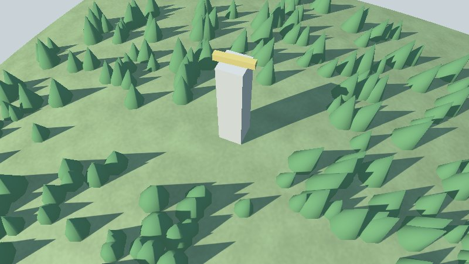

# Lesson 2: making things move

A lighthouse needs a lamp that turns, and an island needs trees. In this lesson you learn the
**update function**, how a **child node** follows its parent, and how **instancing** draws three
hundred trees for the price of one.

| Mission | Pieces | Time |
|---|---|---|
| A lamp that turns, and a forest | the update function, child nodes, `Instances` | 15 min |

#### The idea

A **clockmaker** sets the hands on the dial, and the dial on the clock: move the clock and the hands go with it. A child node is a hand on its parent's dial. And a forest is a **rubber stamp**: one tree, stamped three hundred times, each copy in its own place.

## The update function

`viewer.Run`'s fourth argument is a function the viewer calls at a **fixed step**, sixty times a
second whatever the frame rate, before it draws:

```go
type UpdateFunc func(world *scene.Scene, state *input.State, step float64)
```

`step` is the time since the last call, in seconds (always the same, 1/60). Changing the scene
inside it is safe: it runs on the same goroutine as the drawing, so there is nothing to lock.

## A child node

The lamp is a flat bar on top of the tower. As a **child** of the tower it takes the tower's
transform first, so its own `Translate` is measured from the tower's foot:

```go
lamp := &scene.Node{
	Name:      "lamp",
	Transform: graphics.Translate(graphics.Vec4{0, 8, 0, 1}), // eight metres up the tower
	Mesh:      box(3, 0.5, 0.5, graphics.Vec4{1, 0.85, 0.3, 1}),
}
tower.Children = append(tower.Children, lamp)
```

Turning it is a new transform at every step:

```go
angle := 0.0
turnLamp := func(world *scene.Scene, state *input.State, step float64) {
	angle += step * 1.5 // radians per second
	lamp.Transform = graphics.Translate(graphics.Vec4{0, 8, 0, 1}).Multiply(graphics.RotateY(angle))
}
if err := viewer.Run(world, options, "Island", turnLamp, 0); err != nil {
	log.Fatal(err)
}
```

Moving a node costs nothing to upload: only its matrix changes. Move the tower and the lamp goes
with it.

> 📝 **When does the viewer draw?** Without an update function it draws *on demand*: only while
> you move the camera or a key is held, and sleeps in between. With one, it draws every frame,
> since a program that animates may change anything at any step.

## A forest with instancing

Three hundred nodes of three hundred meshes would be three hundred draw calls. A node with
**instances** draws one mesh many times in a single call, each copy with its own transform and
tint:

```go
forest := &scene.Node{
	Name:      "forest",
	Transform: graphics.Identity(),
	Mesh:      cone(1, 3, graphics.Vec4{0.2, 0.45, 0.2, 1}),
	Instances: &scene.Instances{},
}
world.Nodes = append(world.Nodes, forest)
plantForest(world, forest.Instances, 300)
```

The tree is a cone:

```go
// cone is a tree: a cone of a radius and a height standing on the origin.
func cone(radius, height float32, color graphics.Vec4) *scene.Mesh {
	const sides = 8
	mesh := &scene.Mesh{Name: "tree", Material: &scene.Material{Kind: scene.KindLit, BaseColor: color}}
	mesh.Positions = append(mesh.Positions, 0, height, 0) // the tip
	for side := range sides {
		angle := float64(side) / sides * 2 * math.Pi
		mesh.Positions = append(mesh.Positions, radius*float32(math.Cos(angle)), 0, radius*float32(math.Sin(angle)))
	}
	for side := range uint32(sides) {
		mesh.Indices = append(mesh.Indices, 0, 1+(side+1)%sides, 1+side)
	}
	mesh.ComputeNormals()
	return mesh
}
```

Each tree is a transform built from a position, a rotation (a quaternion; `{0, 0, 0, 1}` is none)
and a scale, and a colour that multiplies the mesh's own (white leaves it as it is):

```go
// plant adds a tree of a size to the forest, standing at a point.
func plant(forest *scene.Instances, x, y, z, size float32) {
	placement := graphics.FromTranslationRotationScale(
		graphics.Vec4{x, y, z, 1},          // where
		graphics.Vec4{0, 0, 0, 1},          // no rotation (a quaternion)
		graphics.Vec4{size, size, size, 1}, // how big
	)
	forest.Transforms = append(forest.Transforms, placement)
	forest.Colors = append(forest.Colors, graphics.Vec4{1, 1, 1, 1}) // white keeps the mesh's colour
	forest.Dirty = true                                              // added one: upload them all again
}
```

The forest is planted where the hill is above the shore, and not on the lighthouse's doorstep, so
of three hundred tries a little over two hundred grow:

```go
// plantForest plants trees at random places on the hill, above the shore and away from the tower.
func plantForest(world *scene.Scene, forest *scene.Instances, count int) {
	random := rand.New(rand.NewPCG(1, 2)) // the same forest every run
	for range count {
		x, z := random.Float32()*50-25, random.Float32()*50-25
		height, onGround := world.GroundHeight(x, z)
		if !onGround || height < 1 || math.Hypot(float64(x), float64(z)) < 6 {
			continue
		}
		plant(forest, x, height, z, 0.7+random.Float32()*0.6)
	}
}
```



### Telling the renderer what changed

The renderer uploads meshes and instances to the graphics card once. When you change them later,
say so, or it keeps drawing the old ones:

| You changed | Do |
|---|---|
| A node's `Transform` or `Hidden` | Nothing: read every frame |
| Instances added, removed, or most of them moved | `instances.Dirty = true` |
| A few instances | `instances.MarkChanged(3, 17)`: only those are uploaded |
| A mesh's positions, colours or indices | `mesh.Dirty = true` |
| A walkable mesh | Also `world.InvalidateGround()`, so `GroundHeight` sees it |

Forests of a hundred thousand trees stay fast: instances are kept in cells, cells out of sight are
skipped, and a mesh with simpler versions (`Mesh.Details`) uses them far away
([architecture](../4-guides/1-architecture.md#the-scene-renderers)).

#### Checkpoint

The lamp on top of the tower turns, about a turn every four seconds, and a forest of cones covers the hill but not the tower's doorstep.


## What you learnt

- The update function runs at a fixed step on the drawing goroutine: change the scene there.
- Children inherit their parent's transform.
- Instancing draws one mesh many times; `Dirty` and `MarkChanged` tell the renderer what changed.

## Bonus (optional)

Make the trees different: tint each a slightly different green, and turn each about its trunk by a
random angle.

<details>
<summary>🔓 Show the solution</summary>

A rotation of an angle about the vertical axis is the quaternion `{0, sin(angle/2), 0,
cos(angle/2)}`:

```go
turn := random.Float64() * 2 * math.Pi
rotation := graphics.Vec4{0, float32(math.Sin(turn / 2)), 0, float32(math.Cos(turn / 2))}
shade := 0.8 + random.Float32()*0.4
forest.Colors = append(forest.Colors, graphics.Vec4{shade, 1, shade, 1})
```

</details>

---

[← Lesson 1](1-meshes-and-nodes.md) · [Lesson 3: light, sky and water →](3-light-sky-and-water.md)
