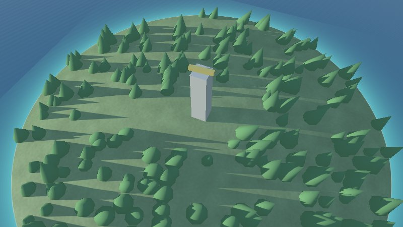
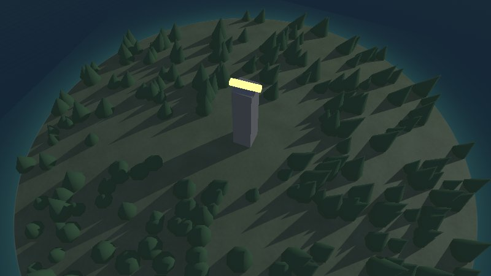
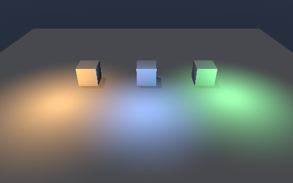

# Lesson 3: light, sky and water

So far the island floats in grey. In this lesson you fill `scene.Environment`: the sea around it,
fog in the distance, wind in the trees, clouds, and the night, with a lamp that glows in it.

| Mission | Pieces | Time |
|---|---|---|
| The sea, the wind, clouds and the night | `scene.Environment`, `Water`, `Sky`, `GlowKind` | 15 min |

#### The idea

The scene's **weather report**: one struct says where the sun is, how far the fog reaches, how high the sea comes and which way the wind blows. There is no clock in it: **the sun's height is the time of day**, as a sundial reads it.

## The environment

Everything that is not a node lives in `world.Environment`: the sun, the sky, fog, water, wind,
snow and the season's tint on leaves. `scene.New()` starts from `scene.DefaultEnvironment()`, a
clear afternoon; you change only what you need.

### The sea

`Water` is an endless animated plane at a height. It is coloured by how deep the water is over the
ground below it, so the shore shines turquoise and the open sea turns dark blue on its own:

```go
world.Environment.Water = &scene.Water{
	Level:   1,    // one metre above zero: the hill's edges go under
	Size:    2000, // how far the plane reaches
	Shallow: graphics.Vector{0.1, 0.5, 0.55, 1},
	Deep:    graphics.Vector{0.02, 0.12, 0.25, 1},
}
```

### Fog and wind

```go
world.Environment.FogColor = graphics.Vector{0.75, 0.8, 0.85, 1}
world.Environment.FogNear, world.Environment.FogFar = 80, 400 // FogFar 0 means no fog
world.Environment.Wind = scene.Wind{Direction: graphics.Vector{1, 0, 0.3, 0}, Strength: 0.5}
```

The wind moves the clouds and bends every material with a `Sway`. Plants are modelled with their
base at the origin and a height of one; the higher a vertex, the more it bends:

```go
forest.Mesh.Material.Sway = 0.3
```

### Clouds

`scene.Sky` describes the sky over a whole day: stars, a moon with phases, clouds, constellations,
or pictures (a skybox). Start from Earth's:

```go
sky := scene.DefaultSky()
sky.Clouds = scene.Clouds{Coverage: 0.4, Color: graphics.Vector{1, 1, 1, 1}, Speed: 0.01, Scale: 1}
world.Environment.Sky = sky
```



## Day and night

There is no clock in the renderer: **the sun's height is the time of day**. Above the horizon it
is day, near it twilight, below it night, when the moon lights the scene and the stars turn about
the pole. `Environment.SunDirection` points towards the sun; the viewer's keys `I` `K` `J` `L` move
it and `N` jumps between day and night, and the flags `-night`, `-sun-elevation` and `-sun-azimuth`
start there.

A lighthouse should shine at night. A **glowing** material is lit like any other by day and shows
its own colour in the dark:

```go
lamp.Mesh.Material.Kind = scene.GlowKind
```

```bash
go run . -night
```



### Lamps that light around them

A glowing lamp shows itself, but lights nothing around it. A **point light** does: it shines
from a point all around, full within its inner radius and fading smoothly to nothing at its
outer one, and lights the lit materials it reaches, besides the sun and the sky:

```go
world.Lights = []scene.PointLight{{
	Position: graphics.Vector{2, 3.2, 0, 1},       // the lamp, at the top of the tower
	Color:    graphics.Vector{1, 0.85, 0.5, 1.5},  // warm, at one and a half times (alpha is the intensity)
	Inner:    0.5,
	Outer:    6,
}}
```

<p align="center"></p>

**How many?** As many as the scene wants, but each draw takes at most the four nearest whose
reach meets it (`MaxLightsPerDraw` in the module's `internal/sceneplan`), chosen once a frame on the processor, so the
shaders stay short on every platform: this is what Unity's and Godot's forward renderers do on
phones. Lamps far apart can light a whole village; four lamps piled on one small thing are as
many as it shows. Move a lamp by changing its position between frames. The 3DS bakes the lamps
into its colours with the sun (its guide).

### Material kinds

| Kind | Shading |
|---|---|
| `LitKind` | Sun or moon, sky light, point lights, shadows, fog: most things |
| `UnlitKind` | Its colour as it is (plus fog): flags, markers, things that should not darken |
| `GlowKind` | Lit by day, shining in the dark: lamps, windows, glowing flowers |
| `WaterKind` | An animated water surface: a river or a lake above the sea's level |
| `WaterfallKind` | Translucent falling water |

#### Checkpoint

The hill rises out of a sea, turquoise at the shore and dark further out; the trees sway; with `-night`, the lamp glows yellow over the dark island.


## What you learnt

- `Environment` holds the sun, the sky, fog, water, wind and snow.
- The sun's height is the time of day; the night comes with the moon and the stars.
- `Sway` bends plants in the wind; `GlowKind` shines at night; `Lights` light around them.

## Bonus (optional)

Give the island a winter: snow above two and a half metres, fading in over half a metre, and
foliage turned a little brown.

<details>
<summary>🔓 Show the solution</summary>

```go
world.Environment.Snow = &scene.Snow{Level: 2.5, Blend: 0.5, Color: graphics.Vector{0.95, 0.97, 1, 1}}
forest.Mesh.Material.Foliage = true // takes the season's tint
world.Environment.FoliageTint = graphics.Vector{0.55, 0.45, 0.3, 0.5} // the colour, and how much
```

Snow settles on surfaces facing up, so the tower's walls stay clear.

</details>

---

[← Lesson 2](2-making-things-move.md) · [Lesson 4: labels and the overlay →](4-labels-and-the-overlay.md)
