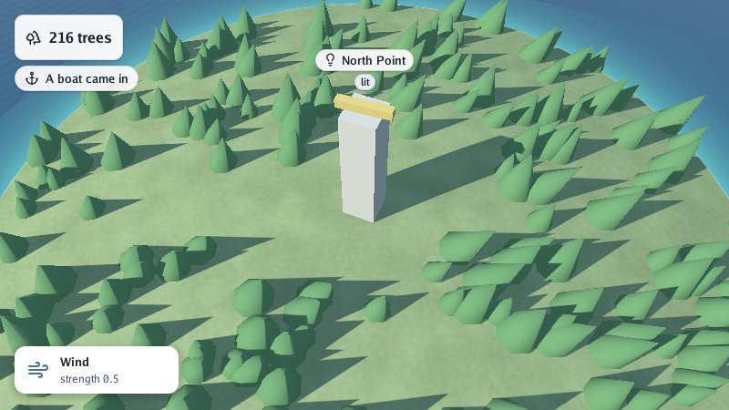

# Lesson 4: labels and the overlay

A 3D view often needs words: the name of a place, the time, a message that something happened. In
this lesson you put a **label** over the lighthouse, a **header** in the corner, a **notice** that
fades, and a small card drawn with **`draw2d`**, Go Renderer's flat drawing.

| Mission | Pieces | Time |
|---|---|---|
| Names and messages on screen | `Overlay`, labels, the header, notices, `draw2d` | 15 min |

#### The idea

A map in a **museum** has little cards on it: a name pinned over each thing, a title in the corner, and the guide's latest news. The overlay is that glass over the scene: it stays the same size however close you come.

All of it lives in `world.Overlay`, drawn over the scene in screen space: it stays the same size
however far the camera is, and costs one draw call.

## A label over the lighthouse

```go
world.Overlay.AddLabel(&scene.Label{
	Node:   tower,        // follows the tower, and hides with it
	Height: 9,            // metres above the tower's origin: just over the lamp
	Icon:   "lightbulb",  // any Lucide icon by name: https://lucide.dev/icons
	Text:   "North Point",
	Badge:  "lit",        // a short word in a pill under the label
})
```

A label without a `Node` stands at a `Point` of the world instead. Keep the pointer to change it
later (`label.Text = "…"`, `label.Hidden = true`) or remove it (`world.Overlay.RemoveLabel`).

## The header and notices

The **header** is a few lines pinned to the top-left corner: a clock, a count, a status. A
**notice** is a short message under it that fades after six seconds (`Overlay.NoticeDuration`),
newest first:

```go
world.Overlay.Header = []scene.HeaderLine{{Icon: "trees", Text: treeCount(forest.Instances)}}
world.Overlay.AddNotice("anchor", "A boat came in", graphics.Vec4{}) // a zero tint: the text's colour
```

```go
func treeCount(forest *scene.Instances) string {
	return fmt.Sprintf("%d trees", len(forest.Transforms))
}
```

> 💡 **Without code.** A glTF file can carry labels too: a node with `"label"`, `"icon"` or
> `"badge"` in its extras gets one, and `"pinned": 1` makes it a line of the header instead
> ([glTF extras](../4-guides/4-gltf-extras.md)).

## Drawing your own: `draw2d`

Labels and notices are fixed shapes. For anything else, `Overlay.Drawing` takes a `draw2d.List`:
rounded rectangles, soft shadows, lines of text, icons and pictures, in **layout pixels** from the
window's top-left corner (the renderer multiplies them on a high-density screen, so text stays
sharp). It is the same list Go UI fills with its panels and buttons.

```go
card := &draw2d.List{}
world.Overlay.Drawing = card
drawWindCard(card, world.Environment.Wind.Strength)
```

```go
// drawWindCard paints a card in the bottom-left corner with the wind's strength.
func drawWindCard(drawing *draw2d.List, strength float32) {
	drawing.Reset()
	card := draw2d.Rect{X: 16, Y: 380, Width: 180, Height: 52}
	drawing.Shadow(card, 12, 10, 3, draw2d.Hex("#00000040")) // before what casts it
	drawing.Rectangle(card, 12, draw2d.Hex("#ffffff"), draw2d.Transparent, 0)
	drawing.Icon("wind", card.X+14, card.Y+14, 24, draw2d.Hex("#3b6ea5"))
	drawing.Text("Wind", card.X+50, card.Y+22, 13, draw2d.Bold, draw2d.Hex("#1f2933"))
	drawing.Text(fmt.Sprintf("strength %.1f", strength), card.X+50, card.Y+40, 12, draw2d.Regular, draw2d.Hex("#52606d"))
}
```

`Text` takes the **baseline**, the line letters sit on, not the top of the text. Later commands
cover earlier ones; `SetLayer` puts what follows on a higher layer, and `PushClip` cuts it to a
rectangle. To redraw the card when the wind changes, call `drawWindCard` again from the update
function: `Reset` keeps the list's memory, so a frame allocates nothing.



> 📝 **Buttons?** `draw2d` paints; it does not know about the mouse. For panels, buttons, fields and
> lists that react, use [Go UI](https://github.com/akrck02/go-ui), which fills this same list.

#### Checkpoint

*North Point* floats over the lighthouse with a *lit* badge, the header counts the trees, *A boat came in* fades after six seconds, and the wind card sits in the bottom-left corner.


## What you learnt

- `Overlay` draws in screen space over the scene: labels, a header, notices and a free drawing.
- Labels follow a node or stand at a point; notices fade on their own.
- `draw2d.List` paints rectangles, shadows, text, icons and pictures in layout pixels.

## Bonus (optional)

Keep the header honest: add a second line that says whether it is day or night, and update it at
every step.

<details>
<summary>🔓 Show the solution</summary>

`Environment.Daylight()` works out the light of the moment from the sun's height; `DayAmount` is 1
in full day and 0 at night:

```go
world.Overlay.Header = append(world.Overlay.Header, scene.HeaderLine{})
// in the update function:
daylight := world.Environment.Daylight()
line := &world.Overlay.Header[1]
line.Icon, line.Text = "sun", "Day"
if daylight.DayAmount < 0.5 {
	line.Icon, line.Text = "moon", "Night"
}
```

</details>

---

[← Lesson 3](3-light-sky-and-water.md) · [Lesson 5: editing with the pointer →](5-editing-with-the-pointer.md)
