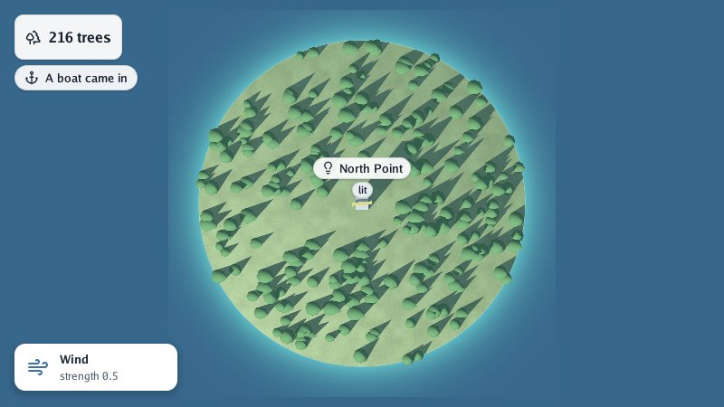

# Lesson 5: editing with the pointer

Until now the program decided everything and the person only watched. In this lesson the island
becomes something you **edit**: a click on the ground plants a tree there. You learn
`viewer.Edit`, the **input state**, and how to find the point of the world under the pointer.

| Mission | Pieces | Time |
|---|---|---|
| Trees planted where you click | `viewer.Edit`, `input.State`, `View.PointOnGround` | 20 min |

#### The idea

A **laser pointer** in a dark room: the dot lands on whatever the beam meets first. The viewer shoots that beam from the camera through the pixel under the mouse and tells you where it meets the ground: that is where the tree goes.

## `viewer.Edit` instead of `viewer.Run`

`viewer.Run` is for programs that change the scene on their own (a simulation). `viewer.Edit` is
for programs that change it **in answer to the person**: a level editor, a floor-plan designer.
Its function looks like an update function, with one more argument:

```go
type EditFunc func(world *scene.Scene, state *input.State, step float64, view viewer.View)
```

- **`state`** is the keyboard and the mouse at this step.
- **`view`** is the camera that drew the frame the person is looking at, and the window's size:
  what is needed to turn a pixel into a place.

`Edit` also keeps drawing **on demand**: while nothing happens the window sleeps and uses no
processor. Our lamp turns all the time, so it asks for the next frame at every step with
`state.RequestFrame(0)`. A program that animates only now and then asks only then.

## The input state

`input.State` is a snapshot of this step, the same on every platform:

| To know | Ask |
|---|---|
| Is a key or button held? | `state.Down(input.KeyW)`, `state.Button(input.MouseLeft)` |
| Did it go down or up during this step? | `state.Pressed(key)`, `state.ButtonPressed(button)`, `state.ButtonReleased(button)` |
| Where is the pointer, and how far did it move? | `state.CursorX`, `CursorY`, `CursorDeltaX`, `CursorDeltaY` (window pixels) |
| A double click? | `state.Clicks(input.MouseLeft) == 2` |
| What was typed? | `state.TypedText()` (after the keyboard layout: «ñ» is one character) |
| The wheel? | `state.ScrollDelta` |
| Fingers on a touch screen? | `state.Touches()`; the first finger is also the pointer |

A drag that turns the camera also ends with the button let go. To tell a click from the end of a
drag, check that the pointer did not move on that step:

```go
// clicked tells whether the left button was let go without the pointer moving: a click, not
// the end of a drag that turned the camera.
func clicked(state *input.State) bool {
	return state.ButtonReleased(input.MouseLeft) && state.CursorDeltaX == 0 && state.CursorDeltaY == 0
}
```

## From a pixel to the ground

`view.PointOnGround(x, y)` follows the ray from the camera through a pixel until it meets a
walkable mesh, and returns that point with its true height; `view.PointOnPlane(x, y, height)` does
the same with a flat floor. They work with every camera: the orbit, walking, and the maps (press
`M`), where clicking is easiest.

```go
angle := 0.0
edit := func(world *scene.Scene, state *input.State, step float64, view viewer.View) {
	angle += step * 1.5
	lamp.Transform = graphics.Translate(graphics.Vec4{0, 8, 0, 1}).Multiply(graphics.RotateY(angle))
	state.RequestFrame(0) // the lamp never stops, so ask for the next frame now

	if !clicked(state) {
		return
	}
	point, onGround := view.PointOnGround(state.CursorX, state.CursorY)
	if !onGround {
		return
	}
	plant(forest.Instances, point[0], point[1], point[2], 1)
	world.Overlay.Header[0].Text = treeCount(forest.Instances)
	world.Overlay.AddNotice("sprout", "A tree was planted", graphics.Vec4{0.3, 0.7, 0.3, 1})
}
if err := viewer.Edit(world, options, "Island", edit); err != nil {
	log.Fatal(err)
}
```



> 📝 **Interfaces and the camera.** When a panel is under the pointer, the camera should not turn
> while you drag a slider in it. An interface **claims** the mouse (`state.ClaimMouse()`) and the
> viewer then gives its cameras `state.Unclaimed()`, a copy without it. go-ui does this for you.

`view` can also move the cameras: `view.FrameGround(minimumX, minimumZ, maximumX, maximumZ)` shows
a rectangle of ground whole, and `view.ZoomBy(2)` comes twice as close, as zoom buttons would.

#### Checkpoint

On the map (`M`), a click on the island plants a tree there, the header counts one more and *A tree was planted* appears; a drag still moves the map without planting.


## What you learnt

- `viewer.Edit` is for programs that change the scene in answer to the person, and it draws on
  demand; `state.RequestFrame` asks for frames while something moves.
- `input.State` tells what is held and what happened during the step.
- `view.PointOnGround` turns the pointer into a point of the world.

## Bonus (optional)

Let a right click take away the tree nearest to the pointer, if it is within two metres.

<details>
<summary>🔓 Show the solution</summary>

Removing an instance changes the list, so the whole forest is uploaded again (`Dirty`):

```go
if state.ButtonReleased(input.MouseRight) {
	if point, onGround := view.PointOnGround(state.CursorX, state.CursorY); onGround {
		removeNearest(forest.Instances, point[0], point[2], 2)
	}
}
```

```go
func removeNearest(forest *scene.Instances, x, z, within float32) {
	nearest, best := -1, within*within
	for index, transform := range forest.Transforms {
		dx, dz := transform[12]-x, transform[14]-z // a matrix keeps its translation in 12, 13, 14
		if distance := dx*dx + dz*dz; distance < best {
			nearest, best = index, distance
		}
	}
	if nearest < 0 {
		return
	}
	forest.Transforms = append(forest.Transforms[:nearest], forest.Transforms[nearest+1:]...)
	forest.Colors = append(forest.Colors[:nearest], forest.Colors[nearest+1:]...)
	forest.Dirty = true
}
```

</details>

## The whole program

Everything from the five lessons, in one file:

```go
// Command island is the go-renderer tutorial's program: a lighthouse on an island, a forest that
// sways, the sea, labels, and trees planted where you click.
package main

import (
	"flag"
	"fmt"
	"log"
	"math"
	"math/rand/v2"

	"github.com/akrck02/go-renderer/draw2d"
	"github.com/akrck02/go-renderer/graphics"
	"github.com/akrck02/go-renderer/input"
	"github.com/akrck02/go-renderer/scene"
	"github.com/akrck02/go-renderer/viewer"
)

func main() {
	options := viewer.DefaultOptions()
	options.RegisterFlags(flag.CommandLine) // -capture, -night, -walk and the rest
	flag.Parse()

	world := scene.New()

	// Lesson 1: a hill and a tower on it.
	island := &scene.Node{Name: "island", Transform: graphics.Identity(), Mesh: hill(60, 4)}
	tower := &scene.Node{
		Name:      "lighthouse",
		Transform: graphics.Translate(graphics.Vec4{0, 4, 0, 1}),
		Mesh:      box(2, 8, 2, graphics.Vec4{0.9, 0.9, 0.85, 1}),
	}
	world.Nodes = append(world.Nodes, island, tower)

	// Lesson 2: a lamp on top of the tower, and a forest.
	lamp := &scene.Node{
		Name:      "lamp",
		Transform: graphics.Translate(graphics.Vec4{0, 8, 0, 1}),
		Mesh:      box(3, 0.5, 0.5, graphics.Vec4{1, 0.85, 0.3, 1}),
	}
	tower.Children = append(tower.Children, lamp)

	forest := &scene.Node{
		Name:      "forest",
		Transform: graphics.Identity(),
		Mesh:      cone(1, 3, graphics.Vec4{0.2, 0.45, 0.2, 1}),
		Instances: &scene.Instances{},
	}
	world.Nodes = append(world.Nodes, forest)
	plantForest(world, forest.Instances, 300)

	// Lesson 3: the sea, fog, wind and clouds; the lamp glows and the trees sway.
	lamp.Mesh.Material.Kind = scene.KindGlow
	forest.Mesh.Material.Sway = 0.3
	world.Environment.Water = &scene.Water{
		Level:   1,
		Size:    2000,
		Shallow: graphics.Vec4{0.1, 0.5, 0.55, 1},
		Deep:    graphics.Vec4{0.02, 0.12, 0.25, 1},
	}
	world.Environment.FogColor = graphics.Vec4{0.75, 0.8, 0.85, 1}
	world.Environment.FogNear, world.Environment.FogFar = 80, 400
	world.Environment.Wind = scene.Wind{Direction: graphics.Vec4{1, 0, 0.3, 0}, Strength: 0.5}
	sky := scene.DefaultSky()
	sky.Clouds = scene.Clouds{Coverage: 0.4, Color: graphics.Vec4{1, 1, 1, 1}, Speed: 0.01, Scale: 1}
	world.Environment.Sky = sky

	// Lesson 4: a label over the lighthouse, a header, a notice and a card of our own.
	world.Overlay.AddLabel(&scene.Label{Node: tower, Height: 9, Icon: "lightbulb", Text: "North Point", Badge: "lit"})
	world.Overlay.Header = []scene.HeaderLine{{Icon: "trees", Text: treeCount(forest.Instances)}}
	world.Overlay.AddNotice("anchor", "A boat came in", graphics.Vec4{})
	card := &draw2d.List{}
	world.Overlay.Drawing = card
	drawWindCard(card, world.Environment.Wind.Strength)

	// Lesson 5: the lamp turns, and a click on the ground plants a tree.
	angle := 0.0
	edit := func(world *scene.Scene, state *input.State, step float64, view viewer.View) {
		angle += step * 1.5
		lamp.Transform = graphics.Translate(graphics.Vec4{0, 8, 0, 1}).Multiply(graphics.RotateY(angle))
		state.RequestFrame(0) // the lamp never stops, so ask for the next frame now

		if !clicked(state) {
			return
		}
		point, onGround := view.PointOnGround(state.CursorX, state.CursorY)
		if !onGround {
			return
		}
		plant(forest.Instances, point[0], point[1], point[2], 1)
		world.Overlay.Header[0].Text = treeCount(forest.Instances)
		world.Overlay.AddNotice("sprout", "A tree was planted", graphics.Vec4{0.3, 0.7, 0.3, 1})
	}
	if err := viewer.Edit(world, options, "Island", edit); err != nil {
		log.Fatal(err)
	}
}

// clicked tells whether the left button was let go without the pointer moving: a click, not
// the end of a drag that turned the camera.
func clicked(state *input.State) bool {
	return state.ButtonReleased(input.MouseLeft) && state.CursorDeltaX == 0 && state.CursorDeltaY == 0
}

// plantForest plants trees at random places on the hill, above the shore and away from the tower.
func plantForest(world *scene.Scene, forest *scene.Instances, count int) {
	random := rand.New(rand.NewPCG(1, 2)) // the same forest every run
	for range count {
		x, z := random.Float32()*50-25, random.Float32()*50-25
		height, onGround := world.GroundHeight(x, z)
		if !onGround || height < 1 || math.Hypot(float64(x), float64(z)) < 6 {
			continue
		}
		plant(forest, x, height, z, 0.7+random.Float32()*0.6)
	}
}

// plant adds a tree of a size to the forest, standing at a point.
func plant(forest *scene.Instances, x, y, z, size float32) {
	placement := graphics.FromTranslationRotationScale(
		graphics.Vec4{x, y, z, 1},          // where
		graphics.Vec4{0, 0, 0, 1},          // no rotation (a quaternion)
		graphics.Vec4{size, size, size, 1}, // how big
	)
	forest.Transforms = append(forest.Transforms, placement)
	forest.Colors = append(forest.Colors, graphics.Vec4{1, 1, 1, 1}) // white keeps the mesh's colour
	forest.Dirty = true                                              // added one: upload them all again
}

func treeCount(forest *scene.Instances) string {
	return fmt.Sprintf("%d trees", len(forest.Transforms))
}

// drawWindCard paints a card in the bottom-left corner with the wind's strength.
func drawWindCard(drawing *draw2d.List, strength float32) {
	drawing.Reset()
	card := draw2d.Rect{X: 16, Y: 380, Width: 180, Height: 52}
	drawing.Shadow(card, 12, 10, 3, draw2d.Hex("#00000040"))
	drawing.Rectangle(card, 12, draw2d.Hex("#ffffff"), draw2d.Transparent, 0)
	drawing.Icon("wind", card.X+14, card.Y+14, 24, draw2d.Hex("#3b6ea5"))
	drawing.Text("Wind", card.X+50, card.Y+22, 13, draw2d.Bold, draw2d.Hex("#1f2933"))
	drawing.Text(fmt.Sprintf("strength %.1f", strength), card.X+50, card.Y+40, 12, draw2d.Regular, draw2d.Hex("#52606d"))
}

// hill is a round island: a grid of side × side cells, highest in the middle and under the sea at
// its edges. Its surface is ground, so the walker and GroundHeight find it.
func hill(side int, height float32) *scene.Mesh {
	mesh := &scene.Mesh{
		Name:   "hill",
		Ground: true,
		Material: &scene.Material{
			Kind:         scene.KindLit,
			BaseColor:    graphics.Vec4{0.45, 0.6, 0.3, 1},
			Pattern:      scene.PatternGrass,
			PatternScale: 1,
		},
	}
	half := float32(side) / 2
	for row := 0; row <= side; row++ {
		for column := 0; column <= side; column++ {
			x, z := float32(column)-half, float32(row)-half
			distance := math.Hypot(float64(x), float64(z)) / float64(half) // 0 in the middle, 1 at the edge
			y := height * float32(math.Cos(math.Min(distance, 1.3)*math.Pi/2))
			mesh.Positions = append(mesh.Positions, x, y, z)
		}
	}
	for row := range side {
		for column := range side {
			corner := uint32(row*(side+1) + column)
			below := corner + uint32(side+1)
			mesh.Indices = append(mesh.Indices, corner, below, corner+1, corner+1, below, below+1)
		}
	}
	mesh.ComputeNormals()
	return mesh
}

// box is a box standing on the origin: width along x, height up y, depth along z. Each face has
// vertices of its own, so its normals stay flat and its edges sharp.
func box(width, height, depth float32, color graphics.Vec4) *scene.Mesh {
	x, z := width/2, depth/2
	corners := [8][3]float32{
		{-x, 0, -z}, {x, 0, -z}, {x, 0, z}, {-x, 0, z}, // bottom
		{-x, height, -z}, {x, height, -z}, {x, height, z}, {-x, height, z}, // top
	}
	faces := [6][4]int{{0, 1, 2, 3}, {7, 6, 5, 4}, {3, 2, 6, 7}, {1, 0, 4, 5}, {2, 1, 5, 6}, {0, 3, 7, 4}}
	mesh := &scene.Mesh{Name: "box", Material: &scene.Material{Kind: scene.KindLit, BaseColor: color}}
	for _, face := range faces {
		first := uint32(len(mesh.Positions) / 3)
		for _, corner := range face {
			mesh.Positions = append(mesh.Positions, corners[corner][:]...)
		}
		mesh.Indices = append(mesh.Indices, first, first+1, first+2, first, first+2, first+3)
	}
	mesh.ComputeNormals()
	return mesh
}

// cone is a tree: a cone of a radius and a height standing on the origin.
func cone(radius, height float32, color graphics.Vec4) *scene.Mesh {
	const sides = 8
	mesh := &scene.Mesh{Name: "tree", Material: &scene.Material{Kind: scene.KindLit, BaseColor: color}}
	mesh.Positions = append(mesh.Positions, 0, height, 0) // the tip
	for side := range sides {
		angle := float64(side) / sides * 2 * math.Pi
		mesh.Positions = append(mesh.Positions, radius*float32(math.Cos(angle)), 0, radius*float32(math.Sin(angle)))
	}
	for side := range uint32(sides) {
		mesh.Indices = append(mesh.Indices, 0, 1+(side+1)%sides, 1+side)
	}
	mesh.ComputeNormals()
	return mesh
}
```

---

[← Lesson 4](4-labels-and-the-overlay.md) · [Lesson 6: scenes from files →](6-scenes-from-files.md)
