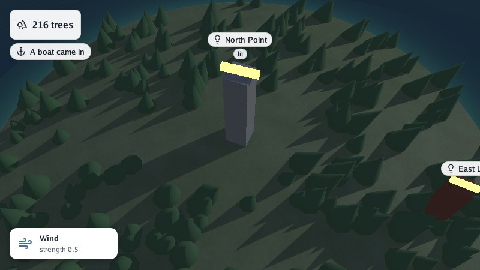
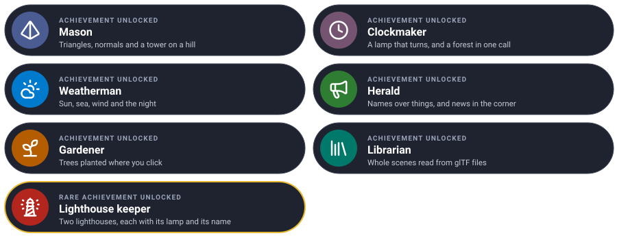

# Lesson 6: scenes from files

Building meshes in Go is good for learning and for things a program generates. Real islands are
modelled in a 3D editor, or built from a map by a tool. In this lesson you load a **glTF** file,
add the renderer's own information to it through **extras**, and carry the scene inside the
program.

| Mission | Pieces | Time |
|---|---|---|
| The island from a file | `loaders.LoadScene`, extras, `ReadScene` | 10 min |

#### The idea

glTF is a **shipping container for 3D**: every tool packs it the same way, so the renderer can unload one from anyone. What the standard boxes have no room for (the tide, the walkable ground, a label) travels in the **extras**, a note taped to each box.

## glTF in one paragraph

[glTF 2.0](https://www.khronos.org/gltf/) is the open format for 3D scenes: nodes, meshes and
materials, in a `.gltf` (JSON beside its binary buffers) or a single `.glb`. Blender exports it
(*File → Export → glTF 2.0*), and so does Go Scene Builder, which turns a 2D map and a relief into
a whole scene.

## Opening a file

```go
world, err := loaders.LoadScene("island.glb")
if err != nil {
	log.Fatal(err)
}
viewer.Run(world, options, "Island", nil)
```

That is the whole of `cmd/visor`, give or take its flags: `go run ./cmd/visor island.glb` opens
any file without writing a line.

The loader reads the node tree, positions, normals, vertex colours (`COLOR_0`), indices, the
base colour of materials with `doubleSided` and `alphaMode`, compressed attributes
(`KHR_mesh_quantization`) and instancing (`EXT_mesh_gpu_instancing`). Textures are not read: colour
comes from materials, vertex colours and the procedural patterns.

## Extras: what glTF cannot say

glTF has no word for the tide, the walkable ground or a label. It lets any object carry free JSON,
its **extras**, and Go Renderer reads its own there. In Blender, *custom properties* become extras
when *Include → Custom Properties* is ticked in the exporter.

| On | Extra | Becomes |
|---|---|---|
| The scene | `environment`: `sunDirection`, `fog`, `water`, `wind`, `sky`, `snow`… | `world.Environment` (lesson 3) |
| A mesh, a primitive or a node | `"ground": true` | `Mesh.Ground`: walkable, found by `GroundHeight` |
| A material | `"kind": "glow"`, `"sway": 0.3`, `"pattern": "cobbles"`, `"patternScale": 0.5` | `Material.Kind`, `Sway`, `Pattern` (lessons 1–3) |
| A mesh | `"detail": [{"mesh": 3, "screenSize": 0.05}]` | Simpler versions drawn far away |
| A node | `"label"`, `"icon"`, `"badge"`, `"label_color"`, `"pinned"` | A label, or a line of the header (lesson 4) |

A node's extras, all of them, are also in `node.Tags`, for your program's own data: a lighthouse's
range, a building's owner. For example, a node exported like this:

```json
{
  "name": "harbour",
  "mesh": 0,
  "extras": { "label": "Harbour", "icon": "anchor", "berths": 12 }
}
```

gets a label with an anchor, and `node.Tags["berths"]` holds `12` (a `float64`, as JSON numbers
are). The full list is in [glTF extras](../4-guides/4-gltf-extras.md).

## Finding nodes

A loaded scene is the same `scene.Scene` you built by hand, so everything in lessons 2 to 5 works
on it. To animate a node, find it by name:

```go
func findNode(nodes []*scene.Node, name string) *scene.Node {
	for _, node := range nodes {
		if node.Name == name {
			return node
		}
		if found := findNode(node.Children, name); found != nil {
			return found
		}
	}
	return nil
}

lamp := findNode(world.Nodes, "lamp")
```

## Carrying the scene inside the program

A program for a web page or a phone has no files beside it. Embed the `.glb` and read it from its
bytes (`ReadScene` takes any `io.Reader`):

```go
//go:embed island.glb
var islandFile []byte

world, err := loaders.ReadScene(bytes.NewReader(islandFile))
```

The buffers must be inside the file, as a `.glb`'s are; a `.gltf` with separate `.bin` files needs
`LoadScene`.

#### Checkpoint

`go run ./cmd/visor island.glb` opens a scene made elsewhere (Blender, Go Scene Builder), and its labels, sea and walkable ground come with it.


## What you learnt

- `loaders.LoadScene` opens a `.glb` or `.gltf`; `ReadScene` reads embedded bytes.
- Extras carry what glTF cannot: the environment, the ground, material kinds, labels.
- A loaded scene is an ordinary `scene.Scene`: find nodes by name and change them.

## Final challenge · Lighthouse keeper

Back in lesson 5's program, build a **second lighthouse** on the island's eastern shore, shorter and red, with its own lamp turning **the other way** and its own label.

> **Hint:** the tower is another node with `box`; the lamp a child of it; `GroundHeight` says where the shore's ground is; the edit function already turns one lamp and can turn two.

Try it on your own first, then compare with the solution.



<details>
<summary>🔓 Show the solution</summary>

```go
height, _ := world.GroundHeight(18, 0)
second := &scene.Node{Name: "east lighthouse", Transform: graphics.Translate(graphics.Vector{18, height, 0, 1}),
	Mesh: box(1.5, 5, 1.5, graphics.Vector{0.75, 0.2, 0.15, 1})}
secondLamp := &scene.Node{Name: "east lamp", Transform: graphics.Translate(graphics.Vector{0, 5, 0, 1}),
	Mesh: box(2, 0.4, 0.4, graphics.Vector{1, 0.85, 0.3, 1})}
secondLamp.Mesh.Material.Kind = scene.GlowKind
second.Children = append(second.Children, secondLamp)
world.Nodes = append(world.Nodes, second)
world.Overlay.AddLabel(&scene.Label{Node: second, Height: 6, Icon: "lightbulb", Text: "East Light"})

// in the edit function, after the first lamp:
secondLamp.Transform = graphics.Translate(graphics.Vector{0, 5, 0, 1}).Multiply(graphics.RotateY(-angle))
```

</details>


## Well done



## Where next

You have used every part of Go Renderer a program usually needs. From here:

- **Put an interface over the island**: panels, buttons, sliders, with
  [Go UI](https://github.com/akrck02/go-ui). Its own tutorial starts where this one ends.
- **Run it elsewhere**: [in a web browser](../4-guides/5-web.md) and [on Android](../4-guides/6-android.md).
- **Understand the inside**: [architecture](../4-guides/1-architecture.md), the [overlay](../4-guides/3-overlay.md), and
  how a frame is planned and drawn.
- **Look things up** in [the reference](../5-reference/0-packages.md).

---

[← Lesson 5](5-editing-with-the-pointer.md) · [Tutorial](0-the-quest.md) · [Reference →](../5-reference/0-packages.md)
