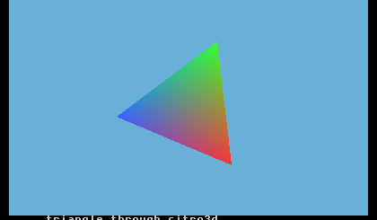
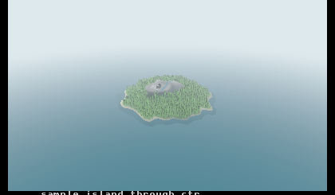
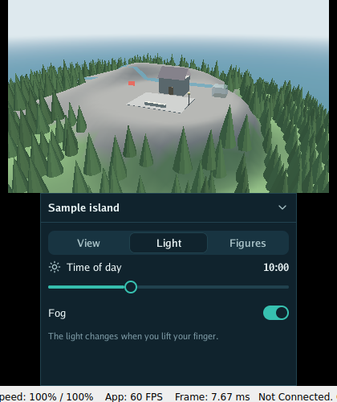
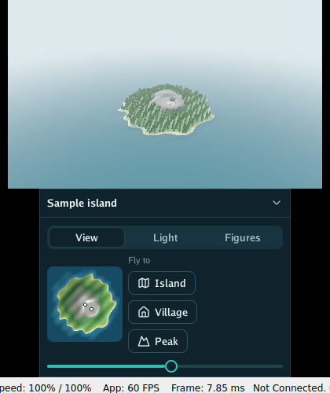

# 🎮 On the Nintendo 3DS

**Status:** a first step (October 2026). Package `ctr` draws through the 3DS's graphics chip, the
PICA200, with citro3d: `cmd/triangle3ds` turns a triangle of three colours on the top screen at 60
frames a second, and `cmd/island3ds` flies round the sample island with `ctr.SceneRenderer`. It runs as homebrew, from the Homebrew Launcher, built with a TinyGo that has a
`nintendo3ds` target (a separate fork of TinyGo, not part of this repository). The triangle is
checked in the Azahar emulator; the loading and planning figures below come from a New 3DS XL.

<p align="center">
  
  
</p>

## How it fits together

| Layer | What it does |
|---|---|
| Your program | Plans frames with `sceneplan`, moves things with `graphics` |
| `ctr` | The top screen, vertex shaders, vertex buffers and matrices, over citro3d (this package) |
| citro3d, libctru | devkitPro's libraries for the GPU and the system, reached through cgo |
| TinyGo `nintendo3ds` | Builds the program as a `.3dsx` for the Homebrew Launcher |

The rest of go-renderer is plain Go and already runs there: on the console, `encoding/json`,
`image/png`, `loaders.ParseSceneGLB` and the sample island load, and planning a frame of the island
takes under a millisecond. The tests of `graphics`, `scene`, `sceneplan`, `camera`, `draw2d`,
`input` and `frameloop` pass in the emulator.

## What is different about the PICA200

- **No fragment shaders.** Vertex shaders are written in the PICA200's assembly (`.v.pica`) and
  assembled with devkitPro's `picasso`; colours come out of a few fixed stages. `ctr` sets the first
  one to pass the vertex colour through.
- **Matrices row by row, components backwards.** citro3d stores a matrix as four rows, and each row
  as w, z, y, x. `graphics.Mat4` is column by column; `ctr.PICAMatrix` lays it out (tested on any
  computer).
- **A screen on its side.** The 3DS's screens are portrait panels turned a quarter turn, and depth
  runs from -1 to 0. `ctr.OrthographicTilt` is citro3d's `Mtx_OrthoTilt` for a right-handed view,
  as everywhere in go-renderer: what is visible lies between z = 0 and z = -far.
  `cmd/triangle3ds` checks it against citro3d's own on the console.
- **Vertex buffers outside the Go heap.** `ctr.NewVertexBuffer` copies vertices to the linear
  memory the GPU reads, so the garbage collector never scans them.

## The scene renderer

`ctr.SceneRenderer` draws a `scene.Scene` the way `gles` does: lit meshes and instances, the light
of the time of day, fog and translucent water, planned by `sceneplan`. What changes on the PICA200:

- **Light worked out on the processor.** Lighting every vertex on the GPU held the sample island
  to 30 frames a second on a New 3DS XL: the GPU took 34 ms a frame, the processor 0.4 ms. Sun and
  sky change slowly, so `ctr/bake.go` lights each vertex once, when a mesh is uploaded (sun, sky
  and ground light, glow, flat by brightness, then the screen's gamma), and keeps its colour in
  four bytes: a vertex is 16 bytes instead of 40. A mesh is baked again only when the light, the
  mesh or its node's turn changes. `ctr/shaders/baked.v.pica` then only places each vertex and
  fogs it by its distance to the camera, linearly: 27 instructions instead of 95. A mesh keeps at
  most four bakes, one per way it is turned; past that the least recently drawn one is baked
  again, so a node that keeps turning doesn't fill linear memory.
- **Moving nodes on the GPU.** Baking is right for a landscape, wrong for a ship that turns every
  frame: each turn means a new bake. A node marked `Moving` (`scene.Node`) is drawn through the
  full shader instead, from a copy of the mesh uploaded once: in a test with sixty ships flying
  around the camera, a frame went from 40 ms of processor time to 16.
- **No seabed without water.** The planner measures the meshes under the water for the sea floor's
  light whenever one of them changes; a scene without water skips it, or a few dozen moving meshes
  were measured vertex by vertex every frame.
- **Water on the GPU, on a coarser grid.** Water's reflection of the sky depends on where the
  camera looks from, so water goes through the full shader, `ctr/shaders/scene.v.pica` (gles's
  scene shader done per vertex, with its smoothstep fog and the chip's `lg2` and `ex2` for gamma).
  The planner's water grid of 256 × 256 cells, made for the desktop's waves, was 131 072 of the
  island's 160 756 triangles; `ctr` asks for 32 × 32 (`Planner.WaterGridDivisions`), still fine
  near the camera for the fog.
- **Not the chip's own fog.** The PICA200 can fog in fixed function, from a table of 128 steps of
  the depth buffer; but depth is far from linear (with the near plane at 0.1 and the far one at
  20 000, the whole island's fog would fall in the first step), so ctr fogs per vertex.
- **OpenGL's matrices, turned.** `sceneplan` plans frames with OpenGL's clip space; one fixed
  matrix (`ctr.PICAViewProjection`) gives the PICA200's quarter turn and depth range. Turning
  `graphics.OrthographicOpenGL` with it gives `ctr.OrthographicTilt` (tested on any computer).
- **16-bit indices.** Meshes with more than 65 535 vertices are drawn in pieces
  (`ctr/split.go`).
- **Instances merged on the processor,** as in `gles`: the merging moved to `sceneplan`
  (`MergedBatch`), which both renderers share.
- **Meshes in linear memory,** uploaded once and again only when `Dirty`.

## The bottom screen

`ctr.FlatRenderer` paints a `draw2d.List` (an interface: go-ui's, or a program's own) on the
bottom screen, as `gles.FlatRenderer` does in browsers and on phones: `opengl/overlay` lays the
list out as rectangles of one atlas of glyphs, icons and rounded corners, and they are drawn in one
call. On the PICA200 the atlas is a texture of one byte per pixel (A8), which has to be laid out
in the chip's own way: tiles of 8 × 8 pixels, from the bottom of the picture, Morton order inside
each tile (`ctr/texture.go`, tested on any computer); a colour stage then multiplies each
rectangle's alpha by the atlas's coverage. Pictures (`draw2d` images) are the overlay's second
atlas, of straight RGBA pixels, tiled the same way as an RGBA8 texture (whose bytes the chip reads
as alpha, blue, green, red); their rectangles multiply the picture by their colour and then by the
coverage, which rounds their corners. Rectangles are drawn in runs, with or without a picture, in
the list's order, so what is painted over what stays the same. Both atlases have to stay within
the chip's 1024 × 1024 pixels, and a picture that changes uploads the whole pictures atlas again.
The chip has no fragment shader to read one picture sharp and another blended, so a sharp picture
(`draw2d.Image`'s `Sharp`, for pixel art) makes its whole list read the pictures atlas at the
nearest pixel: a game's top screen is sharp, the interface below stays smooth.

<p align="center">
  
  
</p>

Both screens are drawn in one frame: `ctr.BeginFrame`, then `SceneRenderer.PaintStereo` for the
top screen and `FlatRenderer.Paint` for the bottom one, then `ctr.EndFrame`. (`Draw` and
`DrawStereo` begin and end a frame themselves, for a program with the top screen only.)
[go-3ds](https://github.com/akrck02/go-3ds) puts go-ui on the bottom screen this way.

## Both screens, and the controls

`ctr.Surface` is either screen: `SceneRenderer.PaintOn` and `FlatRenderer.PaintOn` draw a scene or
an interface on the top one or the bottom one (which has a depth buffer, so a scene can be shown
where it can be touched). go-ui's window for the 3DS uses it to swap the screens with SELECT.

`ctr.ReadControls` reads the buttons, the circle pad and the touch screen, and `ctr.Controls`
turns them into `input.State`: the cross is the arrow keys, L and R minus and plus, A Enter, B
Escape and the system's back, the circle pad the stick (`input.State.StickX` and `StickY`) and the
touch screen the pointer (tested on any computer). The cameras read the stick as a game's player
moves: the orbit and the plan move their target over the ground, the walk walks.

`ctr.Open` asks a New 3DS for its fast mode (804 MHz and the second-level cache): libctru leaves
the processor at 268 MHz otherwise, a third of what it can do.

`FlatRenderer` keeps the corners of every list it paints, one buffer per list painted in a frame.
A list that draws the same as the frame before (its fingerprint says so) is drawn again from
them, without being laid out: an interface that does not change costs the processor almost
nothing. Each rectangle is four corners and two triangles of a fixed index buffer, written straight
into linear memory.

`ctr.ReadMemory` tells how much of the console's memory is free: the linear memory the GPU reads,
the video memory and the application's region, which holds the Go heap. It is cheap enough to read
every second, for a program that shows its own resources.

## Memory

TinyGo's collector does not move what it keeps, so garbage made over and over fragments the heap
until a large block no longer fits. `ctr` keeps its bake and upload buffers and reuses them, and
lets go of a mesh, on the GPU and in its caches, once it has not been drawn for a second: a
program that makes its scene again (a plan whose machines change colour) leaves nothing behind.

## Keeping a frame short

Measure before changing anything: go-ui's `window.LastFrameTimes` splits a frame into waiting for
the GPU, painting the scene, what is drawn over it, the interface, and handing the frame over.
The processor's time to prepare an interface is not where it costs; laying it out as rectangles
is.

- **The overlay costs by the rectangle.** `FlatRenderer` lays a list out only when it draws
  something else than the frame before; an interface that stands still costs almost nothing. A
  part that changes every frame (a clock, an animation, figures read every second) makes its whole
  list be laid out again: keep it small, or update it seldom.
- **Pixel-art shapes are many rectangles.** A window with an outline, a frame, rounded corners in
  steps and a shadow is fifteen or more; a key with a lip, twenty. They are cheap while they stand
  still and dear on the frames they change. A graph is two rectangles a column (the filled part
  and the track), not one a block.
- **The scene's own drawing goes in both eyes.** With 3D on, `World.Overlay.Drawing` is painted
  twice: keep it to a sight and a label.
- **Waiting for the GPU** is the time the PICA200 took for the frame before: triangles, filled
  pixels and blending. Fewer triangles far away, and fewer layers of transparent rectangles,
  lower it.
- **The New 3DS's fast mode** is on: `ctr.Open` asks for it.

## Garbage

TinyGo's collector stops the program while it runs, so a frame should make as little garbage as
it can. `ctr`, the overlay and the scene planner make none in a steady frame: their lists and
buffers are kept and filled again. What a program builds every frame is the rest; tinygo-3ds's
`NINTENDO3DS.md` lists what makes garbage in TinyGo that would not in Go, and how to find it.

## In 3D

The top screen shows a picture for each eye when the 3D slider is up. `SceneRenderer.DrawStereo`
plans the frame once, for the camera between the eyes, and draws it twice: each eye's camera is
moved sideways by half the separation, looking the same way, and its picture is shifted so that
what lies at the focal distance falls on the plane of the screen (`ctr.EyeViewProjection`, tested
on any computer); nearer comes out of the screen, farther goes in. `ctr.Slider3D` reads the
slider; a program usually makes the separation grow with it. Drawing twice doubles the GPU's
work: the sample island goes from about 5 to 10 ms a frame.

## Building

```bash
tinygo build -target=nintendo3ds -o triangle3ds.3dsx ./cmd/triangle3ds
```

Copy the `.3dsx` to `/3ds/` on the SD card and open it from the Homebrew Launcher.

## Not yet

- How fast the renderer is on the console with the coarser water (baking the light alone went from
  30 to 36 frames a second: the chip was held back by the number of triangles more than by the
  shader). Positions in shorts and fewer triangles far away
  are the next steps if it is not enough.
- A sun that moves all the time bakes the meshes again whenever a colour would change by a step.
- Reading scenes from the SD card: TinyGo's `os` has no file system there yet, so scenes are
  embedded in the program.
- Collection pauses: about 170 ms in the emulator for an 80 MB heap with 30 MB alive. Making
  little garbage every frame keeps them rare.
