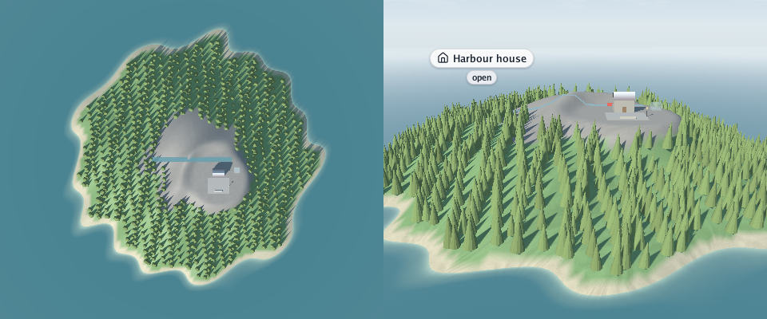
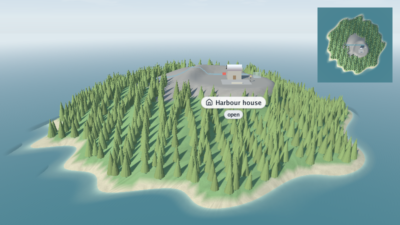

# 🪟 Scenes in areas of the window

This guide is for a Go programmer who draws a scene with `opengl.SceneRenderer` and wants more
than one view in a frame. At the end you will draw a scene into any rectangle of the window, side
by side with another, or floating over it.

## The shortest program: two views side by side

`SceneRenderer.Draw` fills the whole window. `DrawIn` fills only an **area**: a rectangle of the
framebuffer, in its pixels. Two calls make two views, here of the sample island:

<p align="center"></p>

```go
package main

import (
	"log"
	"runtime"

	"github.com/akrck02/go-renderer/graphics"
	"github.com/akrck02/go-renderer/input"
	"github.com/akrck02/go-renderer/models"
	"github.com/akrck02/go-renderer/opengl"
	"github.com/akrck02/go-renderer/scene"
	"github.com/akrck02/go-renderer/scene/sample"
)

func init() { runtime.LockOSThread() } // windows live on the main thread

func main() {
	world := sample.Island()
	above, shore := mapCamera(world), shoreCamera(world)
	var renderer *opengl.SceneRenderer

	app := &models.Application{
		Type: models.WindowApplication, Title: "Two views",
		Width: 960, Height: 400, Input: input.NewState(),
		Renderer: &opengl.OpenGLRenderer{}, // the window's own drawing, unused here
	}
	app.Draw = func(app *models.Application) error {
		if renderer == nil {
			var err error
			if renderer, err = opengl.NewSceneRenderer(); err != nil {
				return err
			}
		}
		width, height := app.Input.FramebufferWidth, app.Input.FramebufferHeight
		half := width / 2
		renderer.DrawIn(world, above, opengl.Area{Width: half, Height: height}, 0)
		renderer.DrawIn(world, shore, opengl.Area{X: half, Width: width - half, Height: height}, 0)
		renderer.DrawOverlay(world, width, height) // once, after every area
		return nil
	}
	if err := (&opengl.OpenGL{}).StartLoop(app); err != nil {
		log.Fatal(err)
	}
}

// mapCamera looks straight down on the whole scene, without perspective.
func mapCamera(world *scene.Scene) models.Camera {
	centre, size := middleAndSize(world)
	return models.Camera{
		Position:           graphics.Vec4{centre[0], size, centre[2], 1},
		Target:             centre,
		Up:                 graphics.Vec4{0, 0, -1, 0}, // north at the top
		OrthographicHeight: size,
		Far:                size * 3,
	}
}

// shoreCamera looks at the middle of the scene from above its southern shore.
func shoreCamera(world *scene.Scene) models.Camera {
	centre, size := middleAndSize(world)
	return models.Camera{
		Position: graphics.Vec4{centre[0], size / 4, centre[2] + size*0.7, 1},
		Target:   centre,
		Up:       graphics.Vec4{0, 1, 0, 0},
		Far:      size * 4,
	}
}

// middleAndSize is the middle of a scene's ground and the larger of its two sides.
func middleAndSize(world *scene.Scene) (graphics.Vec4, float32) {
	minimum, maximum := world.Bounds()
	centre := graphics.Vec4{(minimum[0] + maximum[0]) / 2, 0, (minimum[2] + maximum[2]) / 2, 1}
	return centre, max(maximum[0]-minimum[0], maximum[2]-minimum[2])
}
```

The body of `main` is `ExampleSceneRenderer_DrawIn` in `opengl/example_test.go`, with the three
helpers next to it; `go test ./opengl` checks that it compiles.

## What an area is

`opengl.Area{X, Y, Width, Height}` is in **framebuffer pixels, from the bottom-left corner**, as
OpenGL counts. That is not the cursor's units: on a high-density screen the framebuffer has twice
the window's pixels, and the cursor's y grows downwards. Take sizes from
`app.Input.FramebufferWidth` and `FramebufferHeight`, as above.

Each area gets its own aspect ratio, so a camera never looks stretched.

## The overlay, once

`DrawIn` leaves out the scene's overlay (its labels, notices and `Overlay.Drawing`). The overlay
belongs to the whole window, so `DrawOverlay(world, width, height)` draws it once, after every
area. It places labels with the camera of the **last** area drawn: in the picture, the label
follows the shore view on the right.

`Draw(world, camera, width, height, seconds)` is simply `DrawIn` over the whole window followed by
`DrawOverlay`.

## A scene floating over another: a radar

`DrawIn` clears its area and draws the sky behind the scene. `DrawOver` clears only the depth and
draws **no sky**: the scene floats over what is already there. A radar in a corner is the classic
case:

<p align="center"></p>

```go
width, height := app.Input.FramebufferWidth, app.Input.FramebufferHeight
side, margin := height/3, height/30
corner := opengl.Area{X: width - side - margin, Y: height - side - margin, Width: side, Height: side}
renderer.DrawIn(world, view, opengl.Area{Width: width, Height: height}, 0)
renderer.DrawOver(world, radar, corner, 0) // no sky: the view stays round the island
renderer.DrawOverlay(world, width, height)
```

This is the inside of `app.Draw` in `ExampleSceneRenderer_DrawOver`, with `view := shoreCamera(world)`
and `radar := mapCamera(world)`. `Y: height - side - margin` puts the corner at the **top**, since
areas count from the bottom.

Here the sea fills the radar, so it looks square. With a scene that does not reach the edges, the
view behind shows through around it. A frame round the radar is a `draw2d` rectangle in
`Overlay.Drawing`, in layout pixels: divide the area by the screen's scale to place it.

## Previewing a console's two screens

The 3DS has two screens, one above the other. A computer can preview both in one window: `DrawIn`
the top screen's camera into the upper area and the bottom one into the lower area, at the
console's sizes (400 × 240 and 320 × 240) times a zoom. See [on the Nintendo 3DS](8-3ds.md).

## Which to use

| Call | Clears | Sky | Overlay |
|---|---|---|---|
| `Draw` | the whole window | yes | yes |
| `DrawIn` | its area | yes | no: call `DrawOverlay` |
| `DrawOver` | depth only, in its area | no | no: call `DrawOverlay` |
| `DrawOverlay` | nothing | no | the scene's, over the whole window |

## Not yet

Areas are in `opengl` only. The Metal, browser (`gles`) and 3DS renderers draw a scene over the
whole screen.
