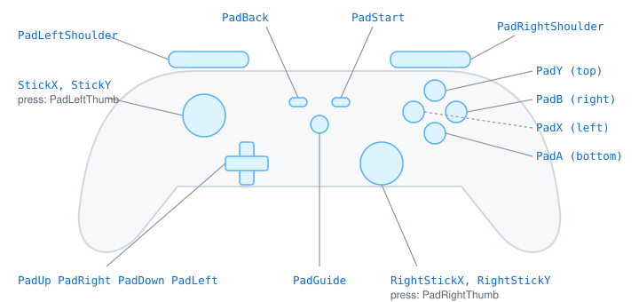

# 🎮 Reading pads and keys, and filling the screen

This guide is for a Go programmer writing a game or a tool with Go Renderer. At the end you will
read keys (F1 to F12 too), a game pad's buttons and sticks, name its buttons the way its maker
does, and put the window on the whole screen.

## The shortest program: F11 for the whole screen

Every backend fills one `input.State`: the desktop window, the browser, Android and the 3DS. A
program gives the application a state and reads it in its update step:

```go
state := input.NewState()
state.Feed().SetKey(input.KeyF11, true) // the backend: F11 went down

if state.Pressed(input.KeyF11) {
	state.SetFullscreen(!state.Fullscreen())
}
fmt.Println(state.Down(input.KeyF11), state.Fullscreen()) // true true

state.Feed().EndFrame() // the backend, after the step: a press lasts one step
fmt.Println(state.Down(input.KeyF11), state.Pressed(input.KeyF11)) // true false
```

In a real program the first `SetKey` and the `EndFrame` belong to the backend: they are on the
state's `Feed()`, the side backends write, so `go doc input.State` shows only what a program
reads. You write the `if`. This is `ExampleState_Pressed` in `input/example_test.go`, and `go test ./input` checks what
it prints. In a window it looks like this:

```go
app := &window.Application{Input: input.NewState()}
app.Update = func(app *window.Application, seconds float64) error {
	if app.Input.Pressed(input.KeyF11) {
		app.Input.SetFullscreen(!app.Input.Fullscreen())
	}
	return nil
}
```

## Keys

| Method | True when |
|---|---|
| `Down(key)` | the key is held now |
| `Pressed(key)` | it went down during this step: once per press |
| `Typed(key)` | it went down or the system repeated it: Backspace held in a text field |

`input.Key` holds letters, digits, arrows, Space, Tab, Enter, Escape, Shift, Control, Alt, the
Command or Windows key (`KeySuper`), and `KeyF1` to `KeyF12`. Characters typed (an "ñ", an "€")
come from `TypedText()`, after the keyboard layout. When an interface has the keyboard (a text
field), it calls `ClaimKeyboard`, and `Unclaimed()` gives the rest of the program a state without
those keys.

## A game pad

<p align="center"></p>

Buttons are read **by position**, like keys: `PadA` is always the bottom face button.

```go
state := input.NewState()
state.Feed().SetStick(0.5, 1) // the backend: half right, all the way up
state.Feed().SetPadButton(input.PadA, true)

const metresPerSecond = 4
const seconds = 0.5
stickX, stickY := state.Stick()
forward := stickY * metresPerSecond * seconds
sideways := stickX * metresPerSecond * seconds
fmt.Println(forward, sideways, state.PadPressed(input.PadA)) // 2 1 true
```

`PadDown(button)` and `PadPressed(button)` work like `Down` and `Pressed`. The sticks are read with
`Stick()` and `RightStick()`, each giving x and y from -1 to 1, **right and up positive**, and 0 at rest. A small dead zone round the middle reads
as 0, since a stick let go never sits exactly there.

| Stick | Read with | On a pad | On a 3DS |
|---|---|---|---|
| Main | `Stick()` | the left stick | the circle pad |
| Second | `RightStick()` | the right stick | a New 3DS's C-stick |

Multiply a stick by a speed and the step's `seconds` to move something smoothly, as above.

## Naming the buttons: the pad's layout

Each maker prints other names on the same buttons. The bottom one is A on an Xbox pad, ✕ on a
PlayStation pad and B on a Nintendo pad. A game that says "Press A" should say what the player sees:

```go
bottomButton := map[input.PadLayout]string{
	input.XboxLayout:        "A",
	input.PlayStationLayout: "✕",
	input.NintendoLayout:    "B",
}
state := input.NewState()
// a browser's name for a pad; a window's backend reads the GUID instead (PadLayoutFromGUID)
state.SetPadLayout(input.PadLayoutFromName("Wireless Controller (STANDARD GAMEPAD Vendor: 054c Product: 09cc)"))
fmt.Println("Press", bottomButton[state.PadLayout()], "to jump") // Press ✕ to jump
```

The backend sets the layout when a pad connects; a program only reads `state.PadLayout()`. It is
worked out from the pad's **USB vendor**, which every system gives, while pad names vary by
driver: 054c is Sony, 057e Nintendo, anything else reads as Xbox. Only the names change: the
Nintendo layout's "B" is still `PadA`, the bottom button.

## The whole screen

`SetFullscreen(true)` **asks** for the whole screen, and `Fullscreen()` tells what was asked. The
backend applies it after the frame, in its own way:

- **A desktop window** (`windowloop`) moves to the screen that holds most of it, at that screen's
  size. Asked no more, it goes back to its place and size. Without a screen (a headless display),
  the request is dropped and `Fullscreen()` turns false.
- **A web page** (`browser`) can take the whole screen only while it answers a key or a click: the
  browser forbids it otherwise. So the request waits for the next press. When the person leaves
  with Escape, `Fullscreen()` turns false, so a toggle stays right.

Leaving needs no such moment, anywhere.

## Which backend reads what

| | Keys, F1–F12 | Pad buttons | Sticks | Pad layout | Whole screen |
|---|---|---|---|---|---|
| Desktop window (GLFW) | yes | first pad | first pad | from the GUID | yes |
| Web page | yes, no F keys yet | not yet | not yet | from the pad's name | on the next press |
| Nintendo 3DS (`nintendo3ds`) | its buttons, as keys | — | circle pad, C-stick | — | always |

On the desktop, GLFW gives every known pad Xbox's order, so one program reads them all the same
way.

## Not yet

A browser does not read a pad's buttons and sticks yet, nor F1 to F12; only the first pad is read
on a computer.
