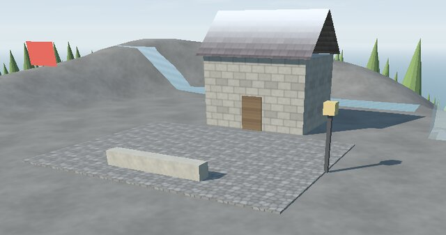
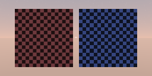

# 🧱 Textures on meshes

This guide is for a program that wants pictures on its 3D surfaces: a tiling detail (stones,
panels, a grid), a picture it makes at run time, or the textures a model brings. At the end you
will know how to give a material a texture, how it repeats, and what each target does with it.

<p align="center">
  
</p>

## A texture in four lines

```go
cobbles, _ := scene.BuiltInTexture("cobbles")
square.Material = &scene.Material{
	BaseColor:    graphics.Vector{0.6, 0.58, 0.55, 1},
	Texture:      cobbles,
	TextureScale: [2]float32{0.5, 0.5}, // one repeat every two units
}
```

The surface's colour is `BaseColor` × its vertex colours × the texture, lit as before. The
built-in textures are grey, so `BaseColor` tints them: one texture serves a red brick wall and a
grey one.

**Where the texture lies** comes from the mesh's `UVs`, two numbers per vertex, as `Positions`
has three: (0, 0) is the picture's top-left corner and (1, 1) its bottom-right. A mesh without UVs
takes them from where its vertices are, one unit of the model a repeat: x and z on what faces up,
along the wall and up on walls (`Mesh.SurfaceUVs`). That is how a terrain or a box made in code
can wear a tiling texture with no UVs at all.

**How often it repeats** is `TextureScale`, the repeats for each unit of UV along u and v (0
counts as 1), and `TextureOffset` slides it, in repeats.

## The built-in textures

`scene.BuiltInTexture(name)` makes a texture in Go the first time it is asked for and keeps it,
so every material that asks for one shares it. Each is a square, 64 or 128 pixels a side, that
repeats without a seam (a test checks each edge runs into the other):

| Surfaces | Details |
|---|---|
| cobbles, masonry, plaster, shingles, planks, grass | panels, grid, stripes, carbon, hexagons, worn, camouflage, windows |

In a `.glb`, a material's extras can ask for one: `"texture": "planks", "textureScale": 2`.

## A picture of your own

Any decoded picture becomes a texture through `draw2d.Image`, the same type 2D lists draw:

```go
picture, err := draw2d.DecodeImage(file) // a PNG, JPEG or GIF
if err != nil {
	return err
}
poster := &scene.Texture{Picture: picture}
```

Give it to as many materials as you like: each backend uploads its pixels once. To show other
pixels, write them into `picture.Pixels` and call `picture.Changed()`: the texture is uploaded
again, once, and every mesh that shows it changes. A picture's colours are sRGB, as a PNG's are,
and come out as they went in under white light.

| Setting | Values | Default |
|---|---|---|
| `Wrap` | `scene.Repeat`, `scene.Clamp`, `scene.Mirror` | Repeat |
| `Sharp` | nearest pixel (pixel art) instead of blended | smooth |
| `Format` | on the 3DS: `scene.RGBA8`, `scene.RGB565`, `scene.ETC1` | RGBA8 |

<p align="center">
  
</p>

## Models that bring their own

`loaders.LoadScene` and `ReadScene` read a glTF's `TEXCOORD_0` and its materials' base colour
texture: a PNG or JPEG inside the `.glb`, in a data URI, or beside a `.gltf` (`LoadScene` only).
The sampler's wrapping along u becomes `Wrap`, and a nearest magnification `Sharp`. Two
materials that name the same texture share one `scene.Texture`.

## On each target

| Target | What it does |
|---|---|
| OpenGL (desktop) | sRGB textures with smaller copies for distance (mipmaps), sampled as each texture asks |
| OpenGL ES (browser, Android) | The same; a picture whose sides are not powers of two is clamped, without smaller copies, as OpenGL ES 2 requires |
| Metal | The same as the desktop; written without a Mac, still to be built and looked at on one |
| Nintendo 3DS | Sides scaled to powers of two from 8 to 1024; RGBA8, RGB565 or ETC1; the texture multiplies the baked light. Water and moving nodes draw without it. See [the 3DS guide](8-3ds.md#textures) |

A scene without textures costs what it did before them: UVs live in a buffer of their own, made
only for meshes drawn with a texture (see [the optimization plan](../6-project/1-optimization-plan.md#textures-2026-10-26)).
