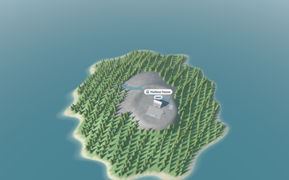
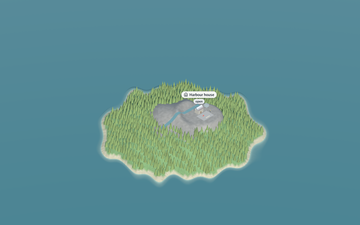
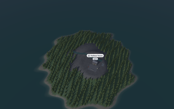
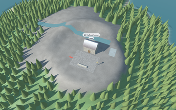
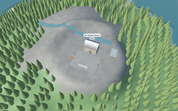

# 🔭 The viewer

`cmd/visor` opens a glTF 2.0 scene (`.glb` or `.gltf`) and lets you explore it: fly around it like
a bird, walk on the ground at eye height, or look at it as a flat map; move the sun to see it at dawn or at night; take a
picture or measure how fast it draws.

```bash
go run ./cmd/visor scene.glb
go run ./cmd/visor -walk scene.glb
go run ./cmd/visor -map scene.glb                 # a 2D map seen from straight above
go run ./cmd/visor -isometric scene.glb           # the same map, at the classic isometric angle
go run ./cmd/visor -capture frame.png scene.glb   # one frame to PNG, hidden window
go run ./cmd/visor -sample island                 # a built-in made-up island, no file needed
go run ./cmd/visor -benchmark 120 scene.glb       # CPU and GPU times per pass, draw calls, triangles
```

<table>
<tr><th width="50%">Orbit (the default)</th><th width="50%">Walking (<code>-walk</code>, or <code>Tab</code>)</th></tr>
<tr>
<td></td>
<td>
<picture>
  <source media="(prefers-color-scheme: dark)" srcset="../images/walk-dark.png">
  
</picture>
</td>
</tr>
<tr>
<td><code>go run ./cmd/visor -sample island</code></td>
<td><code>-sample island -walk -look-at 20,32 -heading 0 -pitch 14</code>, and <code>-sample night</code> for the night</td>
</tr>
</table>

The viewer **draws only when something changes**: a key or button held, the mouse moving the
camera, a camera easing to a stop, the sun turning, a notice fading, the window resized. In
between it sleeps and uses no processor or GPU, and the water and clouds stand still until the next
frame. `-continuous` draws every frame instead; a program that passes an update function (a
simulation) and `-benchmark` always do.

### Editing the scene

`viewer.Edit` shows a scene like `viewer.Run`, for a program that changes it in answer to the user
(a level editor, a floor plan designer). Its function runs at every step, before the viewer's own
controls, and receives a `viewer.View`: the camera that drew the frame the user is looking at and
the window's size. `View.PointOnPlane(x, y, height)` and `View.PointOnGround(x, y)` turn a point of
the window (the pointer, `input.State.CursorX` and `CursorY`) into a point of the scene: on a flat
floor, or on the walkable ground with its relief. The viewer keeps drawing on demand; a program
that claims the mouse (`input.State.ClaimMouse`, as Go UI does over its panels) keeps it from the
camera for that step. `camera.RayThrough` is the ray behind both, for any camera.

```go
viewer.Edit(world, options, "Editor", func(world *scene.Scene, state *input.State, step float64, view viewer.View) {
	if point, onGround := view.PointOnGround(state.CursorX, state.CursorY); onGround && state.ButtonReleased(input.MouseLeft) {
		placeSomething(world, point)
	}
})
```

## Orbit camera (default)

| Control | Action |
|---|---|
| Left drag | Rotate around the target |
| Right drag (or shift + left drag) | Pan |
| Scroll | Zoom |
| `←` `→` | Rotate |
| `↑` `↓` | Tilt |
| `+` `-` | Zoom in or out |

## Walking (`Tab` switches)

| Control | Action |
|---|---|
| `W` `A` `S` `D` | Move forward, left, back, right |
| `↑` `↓` | Move forward or back |
| `←` `→` | Turn |
| Drag with any mouse button | Look around |
| `Shift` | Run |
| `[` `]` | Walk slower or faster (×1.5 per press) |

## Map (`M` switches)

`M` goes round three views: the orbit camera, a map seen from straight above, and an isometric
view, then back to the orbit. Both maps use an orthographic camera: nothing gets smaller with
distance, so lengths and areas can be compared anywhere on screen, as on a printed map. Fog is
lifted while a map is shown.

<table>
<tr><th width="50%">From straight above (<code>-map</code>)</th><th width="50%">Isometric (<code>-isometric</code>)</th></tr>
<tr>
<td></td>
<td></td>
</tr>
</table>

| Control | Action |
|---|---|
| Drag with any mouse button | Move the map (the ground follows the cursor) |
| `←` `→` `↑` `↓` | Move the map |
| Scroll, `+` `-` | Zoom |
| `Q` `E` | Turn a quarter (the top view starts with north up) |
| `Tab` | Leave the map and walk |

## Sun, sky and scene (all modes)

| Key | Action |
|---|---|
| `J` `L` | Turn the sun |
| `I` `K` | Raise or lower the sun (below the horizon it is night) |
| `N` | Jump between day and night |
| `Z` `X` | Less or more vertical exaggeration (orbit only) |
| `F` | Fog (toggle) |
| `O` | Shadows (toggle) |

<table>
<tr><th width="50%">Low sun (<code>-sun-elevation 4 -sun-azimuth 270</code>)</th><th width="50%">Night (<code>-night</code>, or <code>-sample night</code>)</th></tr>
<tr>
<td></td>
<td></td>
</tr>
</table>

## Options

| Option | Effect |
|---|---|
| `-walk` | Start walking on the ground |
| `-map` | Start with the map seen from above (`-zoom` and `-look-at` work too) |
| `-isometric` | Start with the isometric map |
| `-night` | Start at night |
| `-sun-elevation D` / `-sun-azimuth D` | Place the sun (degrees; negative elevation is below the horizon; azimuth clockwise from north) |
| `-zoom F` | Initial orbit distance as a fraction of the default (0.1 = ten times closer) |
| `-look-at x,z` | Start centred on this point, in scene units; with `-walk`, start walking there |
| `-heading D` | With `-walk`, start facing this way: degrees clockwise from north (−z) |
| `-pitch D` | With `-walk`, start looking up this many degrees (negative = down) |
| `-eye-height H` | With `-walk`, eye height in scene units (0 = a share of the scene size) |
| `-walk-speed S` | Walking speed in scene units per second (0 = a share of the scene size); `[` `]` then change it within a range around it, so a small scene in large units (a plant in kilometres) walks at a person's pace |
| `-no-shadows` | Start without sun shadows |
| `-width` / `-height` | Window size |
| `-capture frame.png` | Render one frame to a PNG with a hidden window, and exit (the [overlay](3-overlay.md) included) |
| `-benchmark N` | Measure N frames, print CPU and GPU times per pass, draw calls and triangles, and exit |
| `-no-vsync` | Do not wait for the display; the window title shows the real frames per second |
| `-cpu-profile file` | Write a CPU profile of the session for `go tool pprof` |
| `-continuous` | Draw every frame, so the water, clouds and plants in the wind keep moving while nothing else happens |
| `-backend B` | What draws: `automatic` (Metal on macOS, OpenGL elsewhere), `metal` or `opengl` |
| `-sample island` / `-sample night` | Open the built-in sample island (package `scene/sample`) instead of a file |
| `-time S` | Draw every frame as if S seconds had passed: water and clouds stand still, so captures can be compared |

Other programs reuse these options: `viewer.Options.RegisterFlags` adds them to any flag set, as
Go Simulator's live simulator does.

In Go, `viewer.Options` keeps the window's size and the backend at the top and the rest in three
groups, so a program finds a setting by what it is for:

```go
options := viewer.DefaultOptions()
options.Start.Walking = true                 // Start: where the view begins (-walk, -map, -look-at, the sun)
options.Rendering.NoShadows = true           // Rendering: how frames are drawn (-no-shadows, -continuous, -time)
options.Measure.CapturePath = "frame.png"    // Measure: a capture or a benchmark instead of exploring
err := viewer.Run(world, options, "Island", nil)
```

A benchmark writes its report to `options.Measure.Output` (the standard output by default), with
the scene's loading time when the program sets `Measure.LoadingTime`.

<table>
<tr><th width="50%">With shadows (the default)</th><th width="50%">Without (<code>-no-shadows</code>, or <code>O</code>)</th></tr>
<tr>
<td></td>
<td></td>
</tr>
<tr><td colspan="2" align="center"><code>go run ./cmd/visor -sample island -zoom 0.35 -look-at 20,15 -capture frame.png</code></td></tr>
</table>

---

[← All the documentation](../1-overview.md)
