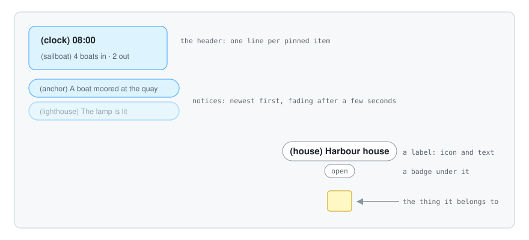
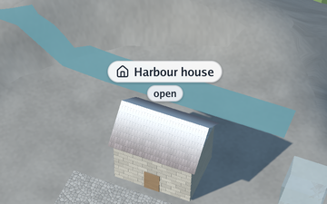

# 🏷️ The overlay: labels, header and notices

Sometimes a picture needs words. Which boat is the ferry? What time is it in the harbour? Did the
lighthouse just switch on? The **overlay** answers those questions with small, light labels drawn
over the 3D view, a header pinned to the top-left corner and short notices that fade away.

<p align="center">
  
</p>

It is **visual only**: nothing on it can be clicked. It is part of the scene (`Scene.Overlay`), so
any program that changes the scene can change it, and headless captures (`visor -capture`)
include it.

## Labels

<p align="center">
  
</p>

A `scene.Label` floats above something in the world:

| Field | Meaning |
|---|---|
| `Node` | The node it follows: it moves with the node's world transform and hides with it |
| `Point` | Where it stands when there is no `Node` (a world position) |
| `Height` | How far above the anchor, in world units: the top of a box, the roof of a house |
| `Text` | A short text, cut with "…" when it is very long |
| `Icon` | The name of a [Lucide](https://lucide.dev/icons) icon (`anchor`, `sailboat`, `clock`…), drawn before the text or alone in a circle |
| `Badge` | A very short text in a small pill under the label: `7/10`, `open` |
| `Tint` | Colour of the icon and the badge, as on a web page (`scene.ColorFromHex("#2563eb")`); the text stays dark |
| `Hidden` | Keep it, but do not draw it |

```go
lighthouse := &scene.Label{Node: lighthouseNode, Height: 30, Text: "Lighthouse", Icon: "lighthouse"}
world.Overlay.AddLabel(lighthouse)
lighthouse.Badge = "lit"                 // change it whenever you like
world.Overlay.RemoveLabel(lighthouse)
```

Labels keep **the same size on screen** however far the camera is, and they are drawn only when
their anchor is in front of the camera and inside the window. When two labels would cover each
other, the one nearer the camera wins and the other waits until there is room: a crowded view stays
readable instead of turning into a pile of pills. Labels also stay clear of the header and the
notices.

## The header and the notices

`Overlay.Header` is a list of lines (`scene.HeaderLine`: icon, text, tint) shown in a card at the
top-left corner; the first line is a little bigger and bolder, for a clock or a title.

Notices are short messages under the header:

```go
world.Overlay.AddNotice("anchor", "Boat 4 moored at the north quay", graphics.Vector{})
```

They show newest first, at most `MaximumNotices` at a time (5 by default), for
`NoticeDuration` seconds (6 by default), fading out over their last second. Their time is the
overlay's own `Clock`, which the viewer advances at every step, so a paused or slowed program does
not lose its notices early.

## Changing it while the scene is shown

`viewer.Run` calls your update function on the same goroutine that draws, between frames, so the
update function can add, change and remove labels, lines and notices freely, with no locking.

## From a glTF file

A file can carry labels too, in its node extras (see [glTF extras](4-gltf-extras.md)): `label`,
`icon`, `badge`, `label_color` and `pinned`. It is a handy way to try the overlay with `cmd/visor`
alone.

## How it is drawn

The overlay is the last pass of the OpenGL scene renderer, after the scene, the sky and the water:

1. **Layout** (package `opengl/overlay`, plain Go, no graphics context needed): every label's
   anchor is projected to the screen, the labels are sorted nearest first, and the header, notices
   and labels are cut into rectangles of one **atlas**.
2. **The atlas** is a single grey image holding coverage masks: the glyphs of the text (Go Medium
   and Go Bold, from `golang.org/x/image/font/gofont`), the icons (the Lucide icon font) and the
   rounded corners of the pills (a disc, a ring and a soft shadow of each size). Pictures are drawn
   into it the first time they are needed, at the exact pixel size they are shown at, so text stays
   crisp; ASCII, Latin-1 and a few signs (`→ … € •`) are drawn as soon as a size is first used.
3. **Drawing**: the atlas is uploaded when it changed, and every rectangle becomes two triangles in
   one draw call, in screen pixels, with alpha blending and no depth test. Pills of any width are
   built from the disc as nine pieces: four corners that keep their size and stretched edges.

**Other scripts.** The Go fonts (or a program's own, `UseFonts`) have Latin, Greek and Cyrillic.
A character they lack (Chinese, Arabic, Devanagari, a symbol) is drawn with one of the system's
fonts, as a system's own text is: `FontFolders` are Android's `/system/fonts`, or the desktop's usual
folders. The font is found by the name of its file, which names its script (`NotoNaskhArabic`,
`NotoSansCJK`, from Go's `unicode` tables); a character of no named font is looked for in every
file under 8 MB, the last resort. Files are read the first time a character needs them, and a font
found is kept, shared by every painter and measurer. Letters are drawn one after another, left to
right: Arabic letters are not joined yet, and right-to-left text is not turned round.

**Emoji** are drawn in their own colours, from the system's colour emoji font: each is a PNG in
the font's `CBDT` table, found through `CBLC` and `cmap`, which `colour.go` reads (`x/image` does
not). An emoji becomes a picture in the picture atlas, scaled once to each size it is drawn at, and
goes in the same draw call as the text, faded as the text is. An emoji by default (a face, a
pictograph, transport) is drawn as a picture before any outline of it; another character is when
it is followed by `U+FE0F` (❤️) or when no font has an outline of it. The variation selectors and
the zero width joiner are not drawn; sequences joined by it (a family, a skin tone) show as their
parts, as the font's ligatures are not read. Android 13 and later draw their own emoji from vector
outlines (COLRv1, not read here) and keep the pictures in `NotoColorEmojiLegacy`, which is used;
the fonts are tried in turn, the one for flags alone last. Tried on the Android 14 emulator:
"North light 🌊 😀 🚀 ❤️ 灯台" in one field.

On a high-density screen one window pixel is two framebuffer pixels; the viewer sets
`SceneRenderer.OverlayScale` so the overlay keeps its size.

The colours aim for calm and contrast: white pills at 92 % opacity with a thin border and a soft
shadow, dark text (`#18212e`), and colour only where it means something (the icon and the badge).

## The icons

The icons come from [Lucide](https://lucide.dev) (ISC licence), copied from the `lucide-static`
npm package into `opengl/overlay/lucide`: the font `lucide.ttf`, its licence and a generated table
from names to characters. `opengl/overlay/lucide/generate.go` explains how to update them. An
unknown icon name draws nothing and is reported once in the log.

## Free drawing: `Overlay.Drawing`

Labels, the header and notices are laid out by the renderer. For anything else drawn over the view
(panels, buttons, a status bar) a program fills a **draw list** of package `draw2d` every frame and
sets `world.Overlay.Drawing` to it once. It is painted last, over the labels.

```go
var drawing draw2d.List
world.Overlay.Drawing = &drawing

// in the update function, every step:
drawing.Reset()
card := draw2d.Rect{X: 24, Y: 24, Width: 220, Height: 64}
drawing.Shadow(card, 10, 10, 3, draw2d.Hex("#14202f2e"))
drawing.Rectangle(card, 10, draw2d.Hex("#ffffff"), draw2d.Hex("#dde3ea"), 1)
drawing.Icon("lightbulb", 40, 48, 16, draw2d.Hex("#4a5768"))
drawing.Text("The lamp is lit", 64, 61, 13, draw2d.Regular, draw2d.Hex("#14202f"))
```

| Command | What it draws |
|---|---|
| `Rectangle(area, radius, fill, border, width)` | A rectangle with rounded corners, a fill and a border inside its area |
| `Shadow(area, radius, blur, drop, colour)` | A soft shadow for a rectangle, fading out over `blur` pixels and falling `drop` pixels |
| `Text(text, x, baseline, size, weight, colour)` | One line of text in Go Regular, Medium or Bold |
| `Icon(name, x, y, size, colour)` | A Lucide icon in a square |
| `Image(picture, area, radius, tint)` | A picture covering a rounded rectangle, cropped evenly where their shapes differ; white tints nothing |
| `PushClip(area)` / `PopClip()` | Cuts what follows to a rectangle (nested clips intersect) |
| `SetLayer(layer)` | Higher layers cover lower ones, whatever order they were added in |

Commands wholly outside the current clip are left out as they are added, so the rows of a long
scrolled list out of sight cost nothing to paint; a text goes when its line misses the clip above
or below, or starts past its right edge. `Fingerprint(seed)` sums up a list in one number: a window
that draws on demand compares it with the last frame's to skip a frame that would look the same.

Coordinates are **layout pixels** from the top-left corner, the same units as the cursor in
`input.State`; on a high-density screen the renderer doubles them, so sizes match on every screen
and text is drawn at its real pixel size. Shapes use the same atlas as the labels (the disc, ring
and shadow pictures, cut into nine pieces), so a whole interface is still one draw call. Clipping
is done on the processor: each rectangle is cut, and its atlas coordinates with it.

To lay text out before drawing it, `overlay.NewMeasurer()` measures a line exactly as it will be
painted (`MeasureText(text, size, weight, scale)`); it needs no graphics context. Every command, with paths and strokes, is in [drawing in 2D](9-drawing-in-2d.md). Interface
libraries such as [Go UI](https://github.com/akrck02/go-ui) build on these two pieces.

### Pictures

A picture is a `draw2d.Image`: `draw2d.DecodeImage(reader)` reads a PNG, JPEG or GIF (a file the
program embeds), `draw2d.NewImage(picture)` takes an `image.Image`, and `draw2d.NewBlankImage`
makes one whose pixels the program writes itself. Keep it between frames: its pixels are uploaded
once. To show other pixels in it (a video's next frame), write them into `Pixels` and call
`Changed`; only its own area is uploaded again. Pixel art sets `Sharp`: scaled up, its pixels stay
square blocks instead of blending into their neighbours. The shaders read such a picture at the
middle of its nearest pixel; the quads say so by adding a large offset (`SharpPictureOffset`, in the module's `internal/shading`) to their
picture position, so every other picture is read as before and the vertices keep their layout.

Pictures sit side by side in a second atlas, of colours (`overlay.Pictures`, RGBA, made with the
first picture). A picture's quads read their colours there and their coverage in the grey atlas,
as any rounded rectangle does, so corners and clips work as for every other shape and the whole
interface stays one draw call. Photos larger than 2048 pixels are scaled down to it as they are
copied in; the atlas grows to 4096 pixels, and when even that is full it is emptied and holds only
the pictures of the frame being drawn.

A program that is only an interface, with no scene, uses `opengl.FlatRenderer`: it clears the
window to a background colour and paints a draw list, with the same atlas and one draw call.

### Frosted glass: backdrops

A translucent panel over a busy picture reads better when what is behind it is blurred, as frosted
glass. `Backdrop` asks for that, just before the panel's own rectangle:

```go
panel := draw2d.Rect{X: 24, Y: 24, Width: 280, Height: 160}
drawing.Backdrop(panel, 12, 24)                                        // blur what is behind by 24 pixels
drawing.Rectangle(panel, 12, draw2d.Hex("#ffffff10"), draw2d.Transparent, 0) // the pane over it
```

The panel's area now shows the frame behind it, blurred, with the pane's faint white on top.

**How it is drawn.** The painter does not blur anything itself. It marks the backdrop's quads, and
before the first backdrop of each layer it asks the backend for a **snapshot**
(`Painter.Snapshots`). The backend stops drawing there, copies the frame so far, shrinks it to half
a few times and blurs the smallest copy in two passes, across and down. Then it goes on drawing,
and every backdrop of that layer reads the blurred copy where it sits on screen.

**What it costs**, and how that is kept small:

- **Nothing, without backdrops.** A list with none is still one draw call, with one more value per
  vertex.
- **One blur per layer, not per panel.** Ten panels of one layer share a snapshot. The price is
  that a panel does not blur another panel of its own layer; a dialog, on a layer above, blurs the
  panels under it.
- **The blur runs on a small picture.** For a 24-pixel blur the copy is halved four times, to a
  sixteenth of the screen's side, so the blur itself works on under half a percent of the pixels;
  halving is a cheap, smooth average of four pixels into one. What is left is moving the frame
  once: on OpenGL it is halved straight from the frame (a multisampled frame is copied first), on
  OpenGL ES 2 copied first, as ES 2 cannot copy and shrink at once.
- **The textures are kept.** They are made the first time and again only when the window changes
  size.
- **Metal** reads the drawable directly, which needs the layer's `framebufferOnly` off on every
  frame: a small cost of its own, frosted or not.

Measured with OpenGL drawn by the processor (llvmpipe, no graphics card: the slowest case), a
frame of ten frosted panels over stripes, against the same frame without backdrops:

| Window | Without backdrops | With backdrops |
|---|---|---|
| 1280 × 760 | 3.1 ms | 5.1 ms |
| 2560 × 1520 | 7.0 ms | 13.5 ms |

A graphics card does the same work in a fraction of that. An interface that draws only when
something changes, as go-ui's window does, pays it only on the frames it draws; over a 3D scene,
which draws every frame, it is paid every frame. A blur of 0 asks for no backdrop at all, so a
system that asks for less transparency costs nothing.

Not done yet: Metal blurs a flat interface's backdrops but not those over a 3D scene, which it
leaves out (the panels show unblurred); and the snapshot is the whole frame, where copying only
the area under the panels would save more on large windows.

### Light: 2D lights

A 2D game looks flat until something is lit: a lamp's warm circle in a dark room, a sign that
glows. Painting a halo over the picture cannot do it, because light also has to *darken* what it
does not reach. So lights work the way Unity's 2D lights do: they are added together into a
**picture of light**, which starts at an ambient colour, and then the frame is **multiplied** by it.

```go
white := draw2d.Color{1, 1, 1, 1}
drawing.Image(room, draw2d.Rect{Width: 400, Height: 240}, 0, white)        // what is lit
drawing.PointLight(200, 120, 20, 80, draw2d.Hex("#ffeeaa"))                // full within 20 px, gone at 80
drawing.SpriteLight(signGlow, draw2d.Rect{X: 40, Y: 30, Width: 64, Height: 32}, white)
drawing.Lighting(draw2d.Color{0.6, 0.6, 0.8, 0.7})                         // the ambient: a dim blue
drawing.Text("Score 10", 8, 20, 16, draw2d.Medium, white)                  // after it: unlit
```

`Lighting` lights everything drawn before it, with the lights added since the last `Lighting`.
What comes after it, such as the interface, keeps its own colours. Inside a clip (`PushClip`) it
lights only the clip: a game's view lit inside an editor leaves the panels around it as they are. A colour's alpha is its
**intensity**: an ambient of `{1, 1, 1, 1}` leaves everything as it is, and an alpha of 0.5 halves it.

**Light can brighten too.** Light is kept at half: 0.5 in the picture of light leaves a colour as
it is, and 1 makes it twice as bright. The multiply counts the light twice (it blends the frame by
the light *and* the light by the frame). So a lamp in daylight still shows, up to twice the
brightness, with no extra cost.

**How it is drawn.** As with backdrops, the painter only marks where each `Lighting` falls
(`Painter.Lightings`), and lays the lights out apart from the other quads (`Painter.Lights`). At
each lighting the backend:

1. clears a picture of light, at half the screen's resolution, to the ambient;
2. adds the lights into it, one square each. A point light's shader fades it smoothly from its
   inner radius to its outer one, and a sprite light shines through its picture;
3. draws the picture of light over the lighting's area (its clip, or the whole frame) with the
   multiplying blend.

**What it costs**:

- **Nothing, without lights.** A list with no `Lighting` draws as before.
- **Half the resolution** for the picture of light, a quarter of the pixels: light is soft, and
  nobody sees the difference.
- **Three steps per lighting**, however many lights it has: a clear, one draw call for all its
  lights, and a full-screen multiply.
- **The texture is kept**, and made again only when the window changes size.

Measured as the backdrops were (llvmpipe, 1280 × 760), a frame of twenty panels takes 1.1 ms,
and 3.0 ms with eight lights. A graphics card does the same work in a fraction of that.

OpenGL ES (Android and the web) draws them the same way, with what OpenGL ES 2 has: a texture to
draw into and two blends.

The 3DS draws them too, in its own way ([its guide](8-3ds.md#2d-lights)).

Metal draws a flat interface's lights the same way, and lights 3D scenes with point lights as
OpenGL does. That code was written on Linux, where Metal cannot be built: it waits for a check on
a Mac (`go test ./metal` compiles its shaders there). Lights in an overlay over a 3D scene are left
unlit on Metal for now, like its backdrops there.

---

[← All the documentation](../1-overview.md)
