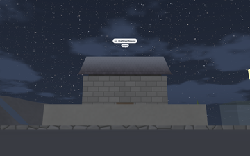

# 🧾 glTF extras read by the renderer

glTF describes geometry and materials, but not things like the sky at night, the tide or which
surfaces you can walk on. The renderer reads those from the file's *extras*: free JSON that glTF
allows on scenes, nodes, meshes and materials. Any program that writes glTF (Go Scene Builder does)
can use them.

<table>
<tr><th width="50%">The sky by day</th><th width="50%">The same sky at night</th></tr>
<tr>
<td></td>
<td></td>
</tr>
<tr><td colspan="2" align="center">The sample island is built in Go, but it uses the same settings a file gives here: <code>sky.clouds</code>, <code>sky.stars</code>, the <code>moon</code>, a constellation, a <code>label</code> with an <code>icon</code> and a <code>badge</code>.</td></tr>
</table>

* scene `extras.environment`: `sunDirection`, `sunColor`, `skyZenith`, `skyHorizon`, `groundAmbient`, `ambient`, `fog {color, near, far}`, `water {level, deep, shallow, size, waveLength, floorDepth, colorDepth, shoreFade, variation}` (the sea fades into the shore over `shoreFade` of depth, with a line of foam; water meshes such as rivers keep their own colour and do not follow the variation), `verticalScale`, `wind {direction, strength}`, `sky`:
  * `nightZenith`, `nightHorizon`, `nightAmbient`, `twilightColor`, `celestialPole`: vectors
  * `stars {density, brightness, twinkle, daytimeVisibility}`
  * `moon {direction, size (degrees), color, phase (0 new, 0.5 full), light}` or `false`
  * `clouds {coverage, color, speed, scale}`
  * `constellations [{name, stars: [[x, y, z], ...] as seen at midnight, lines: [[first, second], ...], color}]`
  * `dayImage`, `nightImage`: `"panorama.png"` or `{faces: [+X, -X, +Y, -Y, +Z, -Z]}`, paths relative to the glTF file (PNG or JPEG); the night image turns with the stars
* `water.variation`: a surface that rises and falls with one harmonic that differs from place to place (tides): `{minimum: [x, z], maximum: [x, z], columns, rows, inPhase: accessor, inQuadrature: accessor, angle}`; the offset at a point is `inPhase·cos(angle) + inQuadrature·sin(angle)`. A simulation moves the angle (`Water.Variation.Angle`); walking uses `Water.LevelAt(x, z)`
* material `extras.kind`: `lit` | `unlit` | `water` | `waterfall`; `extras.depthBias`: share of its distance the surface is pulled towards the camera, so rivers and roads lying on the terrain stay visible over its simpler far versions; `extras.sway`: how much the wind bends it (plants modelled with height 1 and the base at the origin)
* material `extras.texture`: a built-in texture (`cobbles`, `planks`, `panels`…, see [textures on meshes](12-textures-on-meshes.md)) for a material without a texture of its own, repeated `extras.textureScale` times a unit of UV
* mesh `extras.detail`: `[{"mesh": index, "screenSize": fraction of the screen height}, ...]`, simpler versions from finer to coarser; the renderer culls instanced nodes by cells and picks a level per cell
* mesh, primitive or node `extras.ground: true`: walkable surface
* node `extras.label`, `icon`, `badge`, `label_color`, `pinned`: the [overlay](3-overlay.md). A node with a `label` (text), an `icon` (a [Lucide](https://lucide.dev/icons) name) or a `badge` (a short text) gets a label above it, as high as its mesh; `label_color` (`"#rrggbb"`) tints the icon and the badge. With `pinned` (a number) it becomes that line of the header instead: `{"label": "12:00", "icon": "clock", "pinned": 1}`

---

[← All the documentation](../1-overview.md)
