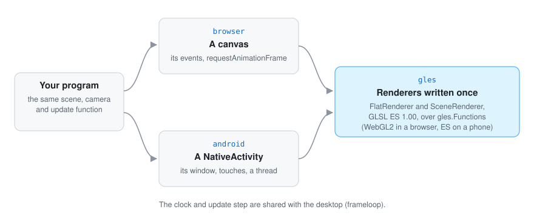

# 🌐 In a web browser

**Status:** a first step (October 2026). The sample island and its labels draw in a browser
through WebGL2, and Go UI interfaces run there too (see Go UI's `docs/web.md`). The desktop is
unchanged. What is still missing is listed at the end.

<p align="center">
  
</p>

```bash
GOOS=js GOARCH=wasm go build -o cmd/web-island/island.wasm ./cmd/web-island
cp "$(go env GOROOT)/lib/wasm/wasm_exec.js" cmd/web-island/
python3 -m http.server -d cmd/web-island 8080      # then open http://localhost:8080
```

Drag to turn around the island, drag with the right button to move, turn the wheel to come
closer.

## What was already portable

Most of Go Renderer is plain Go and builds for WebAssembly as it is: the scene (`scene`), the
frame planning (`internal/sceneplan`), cameras (`camera`), glTF loading (`loaders`), input (`input`), the
2D draw lists (`draw2d`) and the overlay painter with its atlas and fonts (`opengl/overlay`, which
rasterises on the processor and embeds its fonts with `go:embed`). Only three packages are tied to
the desktop, through GLFW and cgo: `opengl`, `windowloop` and `viewer`.

So the browser needed three things: **a window** (a canvas and its events), **a loop** that does
not use GLFW, and **a renderer** that speaks WebGL2.

## How it fits together

<p align="center">
  
</p>

| Layer | What it does |
|---|---|
| Your program | The same scene, camera and update function as on the desktop |
| `browser` (js only) | The canvas, its events → `input.State`, `requestAnimationFrame`, WebGL2 |
| `gles` | `FlatRenderer` and `SceneRenderer`, in GLSL ES 1.00, over `gles.Functions` |
| `frameloop` | The fixed-step clock, shared with `windowloop` |
| `overlay`, `scene`, `camera`… | Unchanged |

### `gles`: renderers written once for OpenGL ES

Browsers draw with WebGL2 (OpenGL ES 3.0) and Android phones with OpenGL ES. So the renderers are
written once, in package `gles`, against a small interface, `gles.Functions`: about forty calls
to make shaders, buffers and textures and to draw. Each platform implements it:

| Platform | Implementation |
|---|---|
| Browser | `browser.WebGL`, over the canvas's `WebGL2RenderingContext` through `syscall/js` |
| Android | `android.GL`, direct calls into the phone's OpenGL ES ([on Android](6-android.md)) |
| Tests | a fake that records the calls, so the renderers are tested on any computer, without a display |

`gles.FlatRenderer` paints a `draw2d.List` on a plain background, like `opengl.FlatRenderer`: the
same atlas, one draw call. `gles.SceneRenderer` draws a scene in its **simplest form**: lit meshes
with vertex colours, instances, the light of the time of day (`Environment.Daylight`), fog,
translucent water and, over everything, the overlay. What a frame draws is still decided by
`internal/sceneplan`, so culling and levels of detail work as on the desktop.

They use **only what OpenGL ES 2.0 has** (plus 32-bit indices, which every current phone has),
because the first Android step went through `golang.org/x/mobile/gl`, which knows no newer
function, and some phones may still give only that; WebGL2 accepts all of it. So the shaders are GLSL ES 1.00, there are no vertex array
objects (each draw describes its vertices, a handful of calls), the atlas is a `LUMINANCE`
texture, and the normal matrix is worked out on the processor (GLSL ES 1.00 has no `inverse`).

Each rectangle of the overlay is six vertices, and OpenGL ES 2 cannot draw instances either. A
call per instance was the first try, and it was far too slow on a phone: the sample island's
forest made about a thousand draw calls, eight thousand calls through the bindings, and a frame
took half a second on the emulator. Now each batch of instances the planner hands over (a level
of detail of a group of cells) becomes **one mesh on the processor**, every copy placed and
tinted, made again only when the batch changes; the island is 16 draw calls a frame. True
instancing, which WebGL2 and OpenGL ES 3 have, would save the memory of the copies, as a later
step behind the same interface.

Each call is costly too: a browser crosses into JavaScript at each, and x/mobile's bindings crossed
to their own thread every three calls (Go Renderer's own `android` package calls OpenGL ES directly). So a program remembers what each uniform holds and sends
only values that changed, and the vertex attributes are switched on once. On a phone dragging the
island, a frame went from about 12.5 to 8.7 ms.

### `browser`: the canvas as a window

- **Size and density.** The canvas fills its place in the page; its drawing buffer is that size
  times `devicePixelRatio`, so text is rasterised at its real pixel size. As on the desktop, the
  cursor is in layout pixels (`WindowWidth`) and drawing in device pixels (`FramebufferWidth`).
- **Input.** Pointer events (mouse, pen and touch alike), the wheel and the keyboard fill an
  `input.State`. A finger is also the pointer, as on Android (`input.TouchPointer`), and every
  finger on the screen is listed in `State.Touches`, for gestures. Keys follow their place on the keyboard (`KeyboardEvent.code`), as GLFW's do;
  typed characters come from `KeyboardEvent.key`. The canvas takes the focus when pressed, and lets
  go of held keys when it loses it.
- **Clipboard.** Copied text is kept by the page and offered to the system clipboard; pasting takes
  what the browser's paste event brings. Reading the system clipboard at any other time needs a
  permission, so it is not done.
- **The loop.** `browser.Run` is `windowloop.Run`'s twin: the same fixed-step clock (now in
  `frameloop`, shared by both), the same drawing on demand. It asks for an animation frame only
  when something happens (an event, a size change, `RequestFrame`, `browser.Wake`), so a page left
  alone does nothing at all: measured, no frames in two seconds of idling, and two after moving
  the pointer once (the frame and its follow-up).
- **Inside a page's own application.** A program can be one screen of a larger web application,
  drawing in a canvas the page gives it (`Options.Canvas` in Go UI). When the page takes that screen
  away, it asks the program to stop (`browser.Stop`): `Run` returns after one more frame, and every
  listener the canvas added (the document's paste among them) and its size observer come off the
  page, so nothing calls into a program that has exited. Opening the screen again starts the
  program again.

## Why this route

| Option | For | Against | Choice |
|---|---|---|---|
| Go, `GOOS=js GOARCH=wasm`, WebGL2 through `syscall/js` | The same compiler and standard library; `go:embed` and the fonts work; WebGL2 is in every browser; the same shaders as Android | A large file (below); each call into JavaScript has a small cost | **Chosen** |
| Go with WebGPU | A modern interface, close to Metal | Not in every browser yet; new shaders in WGSL; the hand-written `webgpu` package is the author's | Later |
| TinyGo | Much smaller files | Partial support for reflection and `go:embed`, which the fonts and the glTF loader use; a second compiler to keep working | Not now |
| Software rendering to a 2D canvas | No GPU needed | Far too slow for the scene | No |

**Size.** The island is a 5.4 MB `.wasm` file, about 1.8 MB compressed with gzip, which web
servers usually do on the fly. The fonts and icons are inside it, so the page loads nothing else.

## Testing

- `go test ./gles ./frameloop` on any computer: the renderers against the fake (shaders are
  GLSL ES 1.00 with nothing newer, one draw call for an interface, the atlas and meshes uploaded only when they
  change).
- `GOOS=js GOARCH=wasm go test ./browser ./gles` runs the browser package's own tests under
  Node.js (key, wheel and button mapping); it needs `$(go env GOROOT)/lib/wasm` in the `PATH`.
- In a browser: the island, turning and zooming, and the idle check above, were looked at in
  Chromium on macOS. Other browsers, phones and tablets have not been tried yet.

## Not yet

- The full scene renderer in WebGL2: shadows, the sky dome with stars and clouds, waves and tides,
  patterns, wind and snow. It is a translation of the desktop shaders to GLSL ES, a larger piece of
  work.
- True instanced drawing, so that very large forests do not cost a copy of each mesh.
- Loading `.glb` files in the page (`fetch`, then `loaders` on the bytes).
- Locking the pointer for the walking camera, the on-screen keyboard, and the system clipboard
  at any time.
- WebGPU, and smaller files with TinyGo.

---

[← All the documentation](../1-overview.md)
