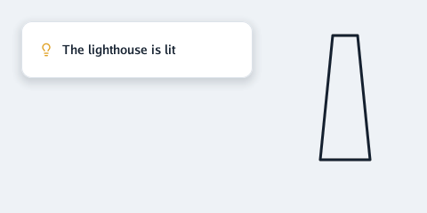

# ✏️ Drawing in 2D

This guide is for a Go programmer who wants flat shapes on screen: a card, a label, a line
drawing. At the end you will know every command of a `draw2d.List` and how to show one.

<p align="center"></p>

## The shortest program

A `draw2d.List` is plain data: a list of shapes for one frame. A renderer paints it. Here a window
draws nothing else, so it uses `opengl.FlatRenderer`:

```go
package main

import (
	"log"
	"runtime"

	"github.com/akrck02/go-renderer/draw2d"
	"github.com/akrck02/go-renderer/input"
	"github.com/akrck02/go-renderer/models"
	"github.com/akrck02/go-renderer/opengl"
)

func init() { runtime.LockOSThread() } // windows live on the main thread

func main() {
	var renderer *opengl.FlatRenderer
	var drawing draw2d.List
	var tower draw2d.Path
	tower.MoveTo(0, 10)
	tower.LineTo(1, 0)
	tower.LineTo(3, 0)
	tower.LineTo(4, 10)
	tower.Close()

	app := &models.Application{
		Type: models.WindowApplication, Title: "Drawing in 2D",
		Width: 480, Height: 240, FlatOnly: true, Input: input.NewState(),
	}
	app.Draw = func(app *models.Application) error {
		if renderer == nil { // the OpenGL context exists from the first frame
			var err error
			if renderer, err = opengl.NewFlatRenderer(); err != nil {
				return err
			}
		}
		drawing.Reset()
		card := draw2d.Rect{X: 24, Y: 24, Width: 260, Height: 64}
		drawing.Shadow(card, 12, 12, 4, draw2d.Hex("#14202f33"))
		drawing.Rectangle(card, 12, draw2d.Hex("#ffffff"), draw2d.Hex("#dde3ea"), 1)
		drawing.Icon("lightbulb", 44, 48, 16, draw2d.Hex("#e0a020"))
		drawing.Text("The lighthouse is lit", 70, 61, 14, draw2d.Medium, draw2d.Hex("#14202f"))
		drawing.Stroke(&tower, 360, 40, 14, 3, draw2d.Hex("#14202f"))

		state := app.Input
		scale := float32(state.FramebufferWidth) / float32(state.WindowWidth) // 2 on a high-density screen
		renderer.Draw(&drawing, draw2d.Hex("#eef2f6"), state.FramebufferWidth, state.FramebufferHeight, scale)
		return nil
	}
	if err := (&opengl.OpenGL{}).StartLoop(app); err != nil {
		log.Fatal(err)
	}
}
```

`go run .` opens the window above. Its body is `ExampleFlatRenderer` in `opengl/example_test.go`,
so `go test ./opengl` checks that it still compiles.

A few things to notice:

- **Coordinates are layout pixels** from the top-left corner, like the cursor in `input.State`.
  The renderer multiplies them by `scale`, so a 14-pixel text has the same size on every screen.
- **The list is filled again every frame.** `Reset` empties it but keeps its memory, so a frame
  allocates nothing.
- **`FlatOnly`** asks for a window without a depth buffer: a flat interface does not need one.

Over a 3D scene, the same list goes in `world.Overlay.Drawing` instead (see
[the overlay](3-overlay.md#free-drawing-overlaydrawing)). In a browser, `gles.FlatRenderer` paints
it, and on the 3DS `ctr.FlatRenderer`.

## Rectangles, shadows, text and icons

These four make most interfaces. The examples of this page are in `draw2d/example_test.go`, and
`go test ./draw2d` runs them and checks what they print.

```go
var drawing draw2d.List
card := draw2d.Rect{X: 24, Y: 24, Width: 240, Height: 64}
drawing.Shadow(card, 12, 12, 4, draw2d.Hex("#14202f33"))
drawing.Rectangle(card, 12, draw2d.Hex("#ffffff"), draw2d.Hex("#dde3ea"), 1)
drawing.Icon("lightbulb", 44, 48, 16, draw2d.Hex("#e0a020"))
drawing.Text("The lighthouse is lit", 70, 61, 14, draw2d.Medium, draw2d.Hex("#14202f"))
fmt.Println(len(drawing.Commands), "commands") // 4 commands
```

| Command | What it draws |
|---|---|
| `Shadow(area, radius, blur, drop, colour)` | A soft shadow for a rounded rectangle, falling `drop` pixels |
| `Rectangle(area, radius, fill, border, width)` | A rounded rectangle; its border is drawn inside the area |
| `Icon(name, x, y, size, colour)` | A [Lucide](https://lucide.dev) icon in a square |
| `Text(text, x, baseline, size, weight, colour)` | One line of text; `y` is its baseline, not its top |

Put the shadow first: later commands cover earlier ones. Colours come from `draw2d.Hex`, with an
optional opacity as the last two digits.

## Clips and layers

A clip cuts what follows to a rectangle. A layer lifts what follows above lower layers, whatever
order it was added in: menus and tooltips use it.

```go
var drawing draw2d.List
box := draw2d.Rect{X: 24, Y: 120, Width: 120, Height: 32}
drawing.Rectangle(box, 6, draw2d.Hex("#f4f6f8"), draw2d.Transparent, 0)
drawing.PushClip(box.Inset(8))
drawing.Text("A line too long for its box", 32, 141, 13, draw2d.Regular, draw2d.Hex("#14202f"))
drawing.PopClip()

drawing.SetLayer(1) // drawn over layer 0, whatever comes after
tip := draw2d.Rect{X: 100, Y: 100, Width: 90, Height: 26}
drawing.Rectangle(tip, 4, draw2d.Hex("#14202f"), draw2d.Transparent, 0)
drawing.Text("Lighthouse", 108, 117, 12, draw2d.Regular, draw2d.Hex("#ffffff"))
fmt.Println(drawing.Commands[1].HasClip, drawing.Commands[3].Layer) // true 1
```

Clips nest: a clip inside another keeps only what both share. A command wholly outside the clip
is left out as it is added, so a long scrolled list costs only its visible rows.

## Images

A `draw2d.Image` is a picture the program keeps between frames, so the renderer uploads it once.
`DecodeImage` reads a PNG, JPEG or GIF; `NewBlankImage` makes one to fill pixel by pixel:

```go
const side = 8
tiles := draw2d.NewBlankImage(side, side)
tiles.Sharp = true // pixel art: no blending between pixels
for y := range side {
	for x := range side {
		if (x+y)%2 == 0 {
			tiles.Pixels.Set(x, y, color.NRGBA{R: 40, G: 120, B: 200, A: 255})
		}
	}
}

var drawing draw2d.List
white := draw2d.Color{1, 1, 1, 1} // a white tint shows the picture as it is
drawing.Image(tiles, draw2d.Rect{X: 24, Y: 24, Width: 64, Height: 64}, 8, white)
```

After changing its pixels, call `tiles.Changed()` so the renderer uploads them again (a video's
next frame). Lights over images and frosted glass are in [the overlay](3-overlay.md#pictures).

## Paths and strokes

A `draw2d.Path` is a line of straight pieces and curves, in the program's own units. Build it with
`MoveTo`, `LineTo`, `CurveTo` and `Close`, or add a whole `Circle` or `RoundedRectangle`.
`List.Stroke` then draws its line:

```go
var tower draw2d.Path
tower.MoveTo(0, 10) // the path's own units: here, one per metre
tower.LineTo(1, 0)
tower.LineTo(3, 0)
tower.LineTo(4, 10)
tower.Close()

var sun draw2d.Path
sun.Circle(0, 0, 1)

var drawing draw2d.List
drawing.Stroke(&tower, 40, 30, 12, 3, draw2d.Hex("#14202f")) // 12 layout pixels a metre
drawing.Stroke(&sun, 120, 40, 10, 2, draw2d.Hex("#e0a020"))
fmt.Println(tower.Bounds()) // {0 0 4 10}
```

`Stroke(path, x, y, scale, width, colour)` puts the path's point (0, 0) at (x, y) of the screen,
and makes each of its units `scale` layout pixels. `width` is the line's thickness in layout
pixels, whatever the scale. `CurveTo` is SVG's `C`: a cubic Bézier curve with two control points.

### Why a stroke is a cached picture

A list only knows rectangles, text and pictures: that keeps every renderer small, from OpenGL to the
3DS. So a stroke is drawn on the processor into a picture of its own, a **mask**. The mask is white,
and the line's coverage is its opacity, with smoothed edges. The list shows it tinted with the
colour, like any image.

Drawing the mask costs time, so the path keeps it. It is drawn again only when the scale or the
width changes. Moving the stroke or changing its colour costs nothing more. So:

- **Keep paths between frames**, as the program above does with `tower`. A path made anew every
  frame draws its mask every frame.
- **Change the colour freely**; change the size only when needed (a zoom, not every frame).
- **A stroke is a picture**, so it covers and is covered like one, and follows clips and layers.

## Not yet

Paths are strokes only: there is no fill of a shape's inside yet, and no dashed lines.
