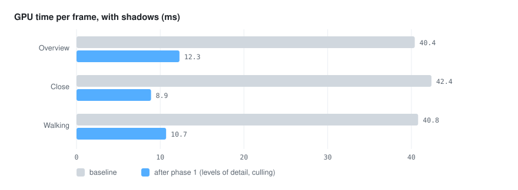

# ⚡ Optimization plan

Measured with `go run ./cmd/visor -benchmark 120 scene.glb` (GPU timer queries per pass, averages
after a warm-up) on an Apple M4, 2560×1600 framebuffer. Test scene: a 60–90 km island exported by
a procedural scene generator (terrain, towns, rivers, 87,069 instanced trees, floating islands).

## Baseline

| View | CPU | GPU shadows | GPU sky | GPU scene | GPU total |
|---|---|---|---|---|---|
| Overview (default orbit) | 20.6 ms | 19.0 ms | 1.1 ms | 20.3 ms | 40.4 ms |
| Close (`-zoom 0.08`) | 22.1 ms | 20.9 ms | 1.1 ms | 20.4 ms | 42.4 ms |
| Walking (`-walk`) | 21.0 ms | 19.8 ms | 1.5 ms | 19.5 ms | 40.8 ms |
| Overview, `-no-shadows` | 2.6 ms | — | 1.5 ms | 20.4 ms | 21.9 ms |

* Every frame draws **17.5 million triangles** in 16 draw calls, and the same again in the shadow pass.
* **Trees are 94 % of them** (16.5 M): 87,069 instances of meshes with 27–260 triangles, drawn
  whole whether they are visible, far away or behind the camera. The terrain is 0.63 M, the sky
  islands 0.21 M, the rest below 0.1 M.
* The cost does not change at 640×400: the renderer is **bound by geometry, not by pixels**.
* With shadows the CPU time jumps from 2.6 to ~21 ms: the driver stalls on the second full-scene
  pass (and the profiler waits for the GPU), so CPU time follows the GPU work.
* Loading takes 55–140 ms and the first frame 25–90 ms (uploads): not a problem today.
* The seabed map costs nothing after the first frame (rendered once); the sky is ~1 ms at full
  resolution.

Result: ~25 fps with shadows, ~45 fps without, in every view.

## Target

60 fps with shadows in every view at 2560×1600 on this machine: **GPU total under 12 ms**, leaving
room for simulations. Every step below is measured with `-benchmark` on the four views of the
baseline table, and its row is added to the results section.

## Phase 1: draw only the trees that matter (largest gain) — done

1. **Levels of detail for instanced meshes.** A mesh can carry simpler versions and the distance
   (in screen size) at which each one is used: full tree near, a low-polygon version (8–30
   triangles) further, a crossed pair of quads or a single billboard far away. Instances are
   sorted into one instance buffer per level each frame (or every few frames), so each level is
   still one draw call. Scene API: `Mesh.Levels []DetailLevel{Mesh, ScreenSize}`; glTF: the
   exporter writes the simpler meshes and names them in the mesh extras. From the overview almost
   every tree is far: 16.5 M → about 1 M triangles. Expected: scene pass 20 → ~3 ms.
2. **Spatial chunks and frustum culling.** Split every instanced node into grid cells (1–2 km)
   with a bounding box each, and skip the cells outside the view frustum. Combined with the
   levels of detail, the walking view draws only nearby trees in full. Also cull plain meshes
   by their bounds (terrain split into chunks, see phase 2).
3. **A cheaper shadow pass.**
   * Draw only casters that touch the shadow region (it is small in close and walking views).
   * Use the lowest level of detail for shadows beyond a short distance.
   * Keep the shadow map between frames when the light direction, the snapped region and the
     casters have not changed (static scenes, a still camera); simulations mark it stale.
   Expected: shadows 19 → 2–4 ms.

### What was done in phase 1
* `scene.Mesh.Details` holds simpler versions with the apparent size (fraction of the screen
  height) below which each one is used; glTF mesh extras `"detail": [{"mesh", "screenSize"}]`.
* Every instanced node is sorted into a grid of cells (about 64 instances each). Each pass (main
  and shadows) keeps the cells inside its frustum, chooses a level per cell from the apparent size
  of its largest instance at its nearest point, and draws one call per level. Instance buffers are
  uploaded again only when the chosen cells change. Single meshes are culled by their box and use
  their levels too.
* The shadow pass culls against the light's frustum and uses the same level as the main pass: one
  level coarser made tree shadows visibly angular in close views.
* The skill exports two simpler trees: fewer faces (below 3 % of the screen height) and, far away,
  an 8-face crown with a 3-sided trunk (below 0.8 %). Without the trunk the far forest looked
  lighter than before, so it stays.
* Keeping the shadow map between frames was left out: plants bending in the wind change the
  shadows every frame, so it would rarely apply.

## Phase 2: steady frame time — done

4. **Terrain in chunks with levels of detail** (quadtree over the height grid, skirts to hide
   cracks): allows culling and keeps distant terrain cheap when scenes grow (the skill can export
   larger terrains).
5. **Partial uploads for simulations**: when a few instances move, upload only their range
   (`glBufferSubData`), and orphan buffers that change every frame, instead of re-uploading
   everything a Dirty flag touches.
6. **Profile the CPU side** once the GPU is lighter: command collection walks the whole scene
   every frame and uniform setting repeats per draw; cache the command list and world transforms
   of nodes that did not change.
7. **Sky at lower resolution** if it ever matters (clouds and stars at half resolution, upscaled);
   today it is ~1 ms.

### What was done in phase 2
* **Steady measurements first.** With vsync the GPU idles between frames and lowers its speed,
  so the same configuration measured 10–16 ms. Benchmarks now disable vsync and add a second
  round without timer queries; its time between frames is the figure to compare (below).
* **Terrain in chunks** (item 4), done in the exporter since the renderer already culls single
  meshes by their box and picks their levels: the skill cuts the height grid into 64×64-cell
  chunks, each with versions keeping one vertex in 2, 4 and 8 (used below 34 %, 17 % and 8.5 %
  of the screen height), and skirts under the edges, deep enough for the largest difference
  between a full and a coarsest edge, so neighbours of different detail leave no cracks. A
  generic quadtree in the renderer was not needed.
* **Partial uploads** (item 5): `Instances.MarkChanged(indices...)` updates only those instances
  in the grid (their cell box grows if they move away) and rewrites only their slot in each batch
  holding them (`glBufferSubData`). Updating 1,000 of 87,000 instances costs 1.3 ms on the
  processor against 20.3 ms to prepare the grid again (plus a full upload). `Dirty` still
  prepares everything again when instances are added or removed.
* **Processor side** (item 6): without timers it takes 0.7–1.4 ms per frame, so caching the
  command list is not worth it yet.
* **Sky** (item 7): instead of a lower resolution (stars are one pixel wide), the sky is drawn
  after the opaque scene with the depth test, so covered pixels cost nothing: 1.1 → 0.2 ms in the
  overview, 1.5 → 0.6 ms walking. Transparent things (water, waterfalls) are drawn after it.

## Phase 3: size and loading — done

8. **Smaller files.** The skill's glTF writer now quantizes (`KHR_mesh_quantization`): colors in
   one byte per channel, normals in one byte per component, 16-bit indices when they fit, and
   positions in 16-bit integers with the center and the scale in the node; instance rotations and
   colors are integers too. Meshes that are instanced keep float positions (the node scale would
   distort every instance), and the levels of a terrain chunk share its box, since they are drawn
   with the same node. The island goes from **76 MB to 33 MB** (19 → 10 MB zipped for sharing).
   * Two fixes came with it. The renderer transformed normals with the model matrix itself,
     wrong for scales that differ per axis; it now uses the inverse transpose (no measurable
     cost). And with quantized positions the writer must store normals in the mesh's own
     coordinates (world normals multiplied by the node scale, normalized): with world normals the
     terrain looked flatter. After both, renders differ from the float file by under one colour
     level on average.
   * Speed does not change (the loader expands to floats) and loading goes from ~60–100 ms to
     ~60 ms.
   * `EXT_meshopt_compression` was left out: it needs a decoder in Go and would save a few more
     megabytes on a file that zips to 10 MB.
9. **Background loading** was not needed: the scene loads in about 60 ms and uploads in about
   80 ms. It becomes worth it for scenes several times larger.

## Out of scope for now

* GPU-driven culling with compute shaders: macOS stops at OpenGL 4.1, which has no compute
  shaders. It would come with a Vulkan or Metal backend.
* Changing the look (fewer trees, lower shadow resolution): the goal is the same image, faster.

## Results

<p align="center">
  
</p>

| Step | View | CPU | GPU shadows | GPU scene | GPU total |
|---|---|---|---|---|---|
| Baseline | Overview | 20.6 ms | 19.0 ms | 20.3 ms | 40.4 ms |
| Baseline | Close | 22.1 ms | 20.9 ms | 20.4 ms | 42.4 ms |
| Baseline | Walking | 21.0 ms | 19.8 ms | 19.5 ms | 40.8 ms |
| Phase 1 | Overview | 8.5 ms | 3.7 ms | 6.5 ms | 12.3 ms (10.1 in another run) |
| Phase 1 | Close | 8.6 ms | 4.3 ms | 2.7 ms | 8.9 ms |
| Phase 1 | Walking | 9.2 ms | 2.9 ms | 4.3 ms | 10.7 ms |
| Phase 1 | Overview, no shadows | 5.0 ms | — | 8.1 ms | 10.7 ms |

Triangles per frame after phase 1: 2.7 M in the overview (was 17.5 M), 1.0 M close, 1.6 M
walking; shadows 1.1–2.4 M (was 17.5 M). Runs vary by about 2 ms; CPU times include waiting for
the GPU timers.

From phase 2 on, measured without vsync; the figure is the time between frames in the round
without timers (the steadiest), with the processor time of that round.

| Step | View | Processor | Time between frames |
|---|---|---|---|
| Phase 1 | Overview | — | 5.54 ms |
| Phase 1 | Close | — | 3.81 ms |
| Phase 1 | Walking | — | 3.24 ms |
| Phase 2 | Overview | 1.35 ms | 4.73 ms (~210 fps) |
| Phase 2 | Close | 0.87 ms | 3.13 ms (~320 fps) |
| Phase 2 | Walking | 0.65 ms | 2.46 ms (~400 fps) |

Triangles after phase 2: 2.2 M in the overview, 0.46 M close, 1.15 M walking.

| Phase 3 | Overview | — | 4.81 ms (same as phase 2) |
| Phase 3 | Walking | — | 2.47 ms (same as phase 2) |

Phase 3 changed the file size, not the speed: 76 → 33 MB, loading ~60 ms.

## Baseline (2026-10-22)

Before the rewrite towards 1.0 ([proposal 1](../proposals/1-towards-version-1.md)), every Go
benchmark was run and kept here, so a rewritten package can show it is no slower and allocates no
more. Run them again with:

```bash
DISPLAY=:95 go test -run xxx -bench . -benchmem -count 3 ./...   # any display works for opengl
```

Machine: AMD Ryzen 5 5600G (8 threads), Linux, Go 1.26.8; the OpenGL ones under Xvfb with Mesa's
llvmpipe, so their times measure the software driver, not a GPU. Each time is the median of three
runs. The four marked *new* were added for this baseline: a frame's hot paths that had none.

| Package | Benchmark | ns/op | B/op | allocs/op |
|---|---|---:|---:|---:|
| `sceneplan` | PlanningAFrameOfTheSampleIsland (*new*: `Plan` with shadows, after the first frame) | 2,262 | 288 | 2 |
| `sceneplan` | UpdateThousandInstances | 367,029 | 12,568 | 0 |
| `sceneplan` | RebuildGrid | 36,349,470 | 9,585,181 | 9 |
| `draw2d` | BuildingAListOfThreeHundredControls (*new*: shadow, rectangle, text and icon each) | 31,244 | 14 | 0 |
| `input` | ReadingAPadForAFrame (*new*: every button set and read, then `EndFrame`) | 19 | 0 | 0 |
| `opengl` | AFrameUnlit (a 2D list drawn and read back) | 690,528 | 182 | 3 |
| `opengl` | AFrameWithEightLights | 2,038,480 | 466 | 4 |
| `opengl/overlay` | AuditPaint2000 (lays out a list of 2,000 commands: the overlay's frame) | 589,448 | 24 | 1 |
| `opengl/overlay` | AuditRegisterPaint, hiddenRows=0 | 149,075 | 24 | 1 |
| `opengl/overlay` | AuditRegisterPaint, hiddenRows=1000 | 148,738 | 24 | 1 |
| `opengl/overlay` | AuditFillVertices | 105,612 | 0 | 0 |
| `opengl/overlay` | AuditFillPacked | 58,160 | 0 | 0 |
| `opengl/overlay` | AuditClipQuads | 268,652 | 159 | 0 |
| `opengl/overlay` | AuditHashList | 19,342 | 0 | 0 |
| `opengl/overlay` | AuditDrawingOrder | 793 | 0 | 0 |
| `opengl/overlay` | AuditRegisterDrawingOrder, hiddenRows=0 / 1000 | 176 | 0 | 0 |
| `opengl/overlay` | AuditRegisterTextLine | 1,485 | 0 | 0 |
| `opengl/overlay` | AuditRegisterHasGlyph | 57 | 0 | 0 |
| `opengl/overlay` | AuditRasteriseGlyph (once per new glyph) | 2,916 | 390 | 2 |
| `opengl/overlay` | AuditShadowMask (once per new shadow size) | 175,587 | 6,592 | 2 |
| `opengl/overlay` | AuditPrebuildFace (loading) | 2,212,267 | 877,105 | 413 |
| `opengl/overlay` | AuditAtlasGrow (loading) | 6,615,328 | 5,505,313 | 8 |

What it says, in short:

* **Planning a frame is cheap** (about 2 µs for the sample island) but still allocates twice; a
  frame of the 2D overlay allocates once (24 B), and an OpenGL frame three or four times. Those are
  the allocations per frame the rewrite should bring to zero.
* **A busy interface costs ~31 µs to describe** (300 controls) and ~150–590 µs to lay out: layout,
  not description, is where the 2D frame's processor time goes.
* **Rebuilding an instance grid** (36 ms, 9.6 MB) happens when instances change, not every frame;
  moving a thousand instances is 0.37 ms with no allocation.
* There were 18 benchmarks before (not the 34 the proposal counted: several names repeat with
  sub-cases); they are named `Audit…` from an earlier review of the overlay, and the rewrite
  should rename them for what they measure.

---

[← All the documentation](../1-overview.md)
