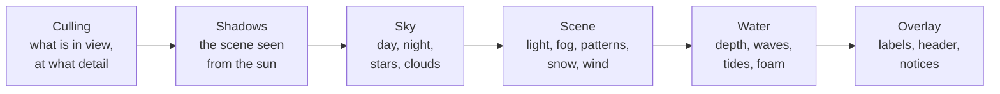

# Architecture

go-renderer is a small renderer written in Go to learn how 3D graphics work from the inside. It
offers two ways to draw:

- **Immediate mode**: your program says "draw this triangle, this image, this model" every frame.
  Simple, and good for learning the pipeline.
- **A retained scene**: a whole world (terrain, towns, forests, sea, sky) is loaded once from a glTF
  file and the renderer draws it every frame, as fast as it can. This is what the viewer and the
  simulators use.

The renderer only draws. It does not know what a town or a season is: other programs change the
scene, and it shows the result.

## Packages

| Package | Role |
|---|---|
| `graphics` | Vectors, matrices, coordinate spaces and transformations; the shader sources |
| `models` | The application loop (`Application`, a fixed time step before every frame), the `Renderer` contract and the backend enumeration |
| `software`, `opengl`, `vulkan`, `metal`, `webgpu` | Backends behind the contract; OpenGL is the complete one. `metal` also has `FlatWindow` and `FlatRenderer`, which draw a flat interface through Metal on macOS ([design](metal.md)) |
| `sceneplan` | Decides what a frame of a scene draws, for any backend: the draw commands in order, culling and levels of detail, instance batches, where the shadow and seabed maps look |
| `scene/sample` | A made-up island that uses every feature the renderers draw, for tests and comparisons |
| `windowloop` | The window loop both OpenGL and Metal use: GLFW events and input, drawing on demand, the fixed-step clock, redrawing while resizing, the pointer's shape and lock |
| `scene` | The retained, backend-independent scene, with its overlay (labels, header, notices) |
| `loaders` | glTF 2.0 loading, including the renderer's extras |
| `opengl/overlay` | Lays out the overlay as rectangles of one atlas of glyphs, icons and rounded corners (no graphics context needed) |
| `draw2d` | A list of flat shapes (rounded rectangles, shadows, text, icons, clips, layers) to paint over the view, filled by a program or an interface library |
| `input` | A backend-independent snapshot of keyboard and mouse state: held keys and buttons, presses and releases, double clicks, typed characters, clipboard, pointer shape, and what an interface claimed |
| `camera` | Camera controllers: orbit, walk and map |
| `viewer` | The interactive explorer behind `cmd/visor` |
| `cmd/visor` | The viewer as a program |

## The immediate-mode contract

An application implements an update and a draw, and calls the renderer every frame:

```go
type Renderer interface {
	RenderPolygon(space graphics.CoordinateSpace, coordinates []graphics.Vec4, shader *string, fill bool) error
	RenderTriangle(space graphics.CoordinateSpace, coordinates []graphics.Vec4, shader *string, fill bool) error
	RenderRectangle(space graphics.CoordinateSpace, coordinates graphics.Vec4, width, height float32, shader *string, fill bool) error
	RenderImage(space graphics.CoordinateSpace, bytes []byte, coordinates graphics.Vec4, width, height float32, shader *string) error
	Render3dObject(space graphics.CoordinateSpace, vertices []graphics.Vec4, shader *string) error
	Render3dModel(space graphics.CoordinateSpace, model *Model, shader *string) error
	SetMatrices(projection, view, model graphics.Mat4)
}
```

Coordinates can be given in local, world or viewport space; the backend does the transformations.
`models.Application.Update` runs at a fixed time step before every frame, so motion does not
depend on the frame rate.

An application that is mostly still (a window of controls) sets `DrawOnDemand`: the loop then
sleeps in `glfw.WaitEvents` and draws only when input arrives, when the program asked for a frame
with `input.State.RequestFrame` (a caret's next blink), or when another goroutine calls
`opengl.Wake` (or `windowloop.Wake`). Each such frame runs one update step, and a frame with input is followed by one
more so hover looks catch up with a layout that just changed. Idle, it uses no processor. `Application.Unchanged` lets an application say a frame would repeat
the last one shown (go-ui compares `draw2d.List.Fingerprint`), and the loop then neither draws nor
presents it. In the default, continuous mode a frame is drawn only after an update step, so a
display faster than the updates does not draw the same picture twice. While a
window is being resized, it is redrawn from GLFW's refresh callback, since macOS holds the loop
until the mouse is let go.

This loop lives in `windowloop` and knows nothing about the graphics interface: `windowloop.Run`
takes the window, the application and a function that draws and shows one frame. The OpenGL
backend and the Metal flat window both use it, so they behave the same way.

## The retained scene

`scene.Scene` is a description of a 3D scene that does not depend on any backend:

- **Nodes** with transforms, children, names and tags (the glTF extras), drawing meshes.
- **Meshes** with positions, per-vertex normals and colours, indices and a **material**: `lit`,
  `unlit`, `water` or `waterfall`, with an optional procedural pattern (cobbles, masonry, plaster,
  shingles, planks, grass), a glow, a sway (how much the wind bends it) and a depth bias.
- **Instances**: one mesh drawn many times (GPU instancing), each copy with its transform and tint.
- **Levels of detail**: simpler versions of a mesh for when it looks small on screen.
- **The environment**: sun, sky, fog, water plane, wind, snow and foliage tint, and the vertical
  exaggeration. `scene.Sky` describes the sky over a whole day, and `Environment.Daylight()`
  derives, from the sun's height, the sky colours and the light of the moment (sun by day, moon by
  night).

Meshes and instances can be marked `Dirty` so a simulation changes them and the backend uploads
them again; `Instances.MarkChanged(indices...)` uploads only the instances that changed.
`GroundHeight(x, z)` answers the height of the walkable meshes through a grid index.

## Loading

`loaders.LoadScene` reads glTF 2.0 (`.glb` or `.gltf`): the node hierarchy, `COLOR_0`, quantized
attributes (`KHR_mesh_quantization`: integer positions, normals, colours and indices),
`EXT_mesh_gpu_instancing` (with a `_COLOR` per instance), and the renderer's
[extras](gltf-extras.md): environment, sky, water, material kinds, levels of detail and walkable
ground.

## The scene renderers

There are two, which draw the same frame: `opengl.SceneRenderer` and, on macOS, `metal.SceneRenderer`
(the viewer chooses with `-backend`; Metal by default on macOS). What a frame draws is decided once,
in `sceneplan`, which makes no graphics calls; each backend only uploads and draws that plan, with
shaders that are faithful translations of each other. Their captures of the sample island match
except for rounding and where two surfaces lie in the same plane (`cmd/visor`'s
`TestMetalDrawsTheSceneLikeOpenGL`; [measurements](metal.md)).

Each uploads each mesh once and draws instanced geometry in a single call, so a
forest of a hundred thousand trees costs a few draw calls. Every frame goes through the same passes:




1. **Culling.** Instances are kept in grid cells; cells outside the view frustum are skipped, and
   each cell picks a level of detail by its size on screen.
2. **Shadows.** A shadow map fitted around the camera target, rendered from the sun, filtered with
   PCF (`ShadowSettings`).
3. **Sky.** A procedural day gradient, twilight glow, stars that turn around the celestial pole, a
   moon with phases that lights the night, clouds that drift with the wind, constellations, or
   skybox images (equirectangular panoramas or six cube faces, one for the day and one for the
   night).
4. **Scene.** Sun or moon light with sky ambient, fog, procedural surface patterns, glowing
   materials, snow on surfaces facing up, the season's tint on foliage, wind sway on plants.
5. **Water.** Coloured by its depth, read from a top-down depth map of the ground that is rendered
   once per scene (and again when a ground mesh is `Dirty`); waves, foam on the shore, tides that
   rise and fall differently from place to place, and waterfalls.
6. **Overlay.** Labels over things in the world, a header and fading notices, and on top of them
   a free 2D drawing (`Overlay.Drawing`, a `draw2d.List`), in screen space with one texture atlas
   and one draw call (see [the overlay](overlay.md)).

## Input, cameras and the viewer

The window backend feeds `input` with a snapshot of the keyboard and the mouse: what is held, and
what happened since the last update step (keys and buttons that went down or up, keys repeated by
the system, characters typed, which click of a double click a press was). An interface drawn over
the view can **claim** the mouse or the keyboard for a step (`ClaimMouse`, `ClaimKeyboard`); the
viewer gives its cameras and shortcuts `State.Unclaimed()`, a copy without what was claimed, so a
slider being dragged does not turn the camera. `camera.Orbit`
(drag, pan, zoom), `camera.Walk` (first person on the ground) and `camera.Plan` (a flat map, from
above or isometric) turn it into a camera placement. A camera with an `OrthographicHeight` is
drawn without perspective: it shows that many scene units from the bottom to the top of the
window, and shadows and levels of detail follow that size instead of the distance to the camera.
The `viewer` package puts it all together: cameras, sun, fog, shadows, vertical exaggeration,
headless captures and benchmarks. `viewer.Run` takes an optional update function called at every
fixed step, so another program can change the scene while it is shown.

## Simulations

The renderer draws the scene as it is and knows nothing about simulations. Moving things, wind
gusts, drifting clouds, the day cycle or growing cities live in the sibling project
[go-simulator](https://github.com/akrck02/go-simulator), which changes the scene through `viewer.Run`. The renderer only
reads the state they leave: node transforms, `Environment.Wind`, `Sky.Clouds.Offset`, the sun
direction, the snow line and the foliage tint.
