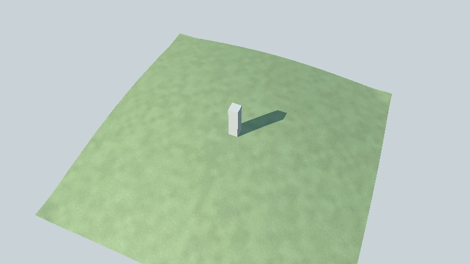

# Get started

This page takes you from nothing to a window showing a 3D scene you built in Go, in about fifteen
minutes. You need to know a little Go (packages, functions, structs); you need no graphics
experience.

**What you will do**

1. Install Go and a C compiler, which the window needs.
2. Get go-renderer and open its sample island.
3. Write a program of your own that shows a box on a square of grass.

> ⚠️ go-renderer is an educational project, not a finished product: its API still changes from one
> week to the next. Pin the commit you build against.

## 1. Install the tools

| You need | Why | How |
|---|---|---|
| **Go 1.25** or later | The language | [go.dev/dl](https://go.dev/dl/), then `go version` |
| **A C compiler** | The window (GLFW) and OpenGL are reached through cgo | Linux: `gcc`; macOS: `xcode-select --install`; Windows: [MinGW-w64](https://www.mingw-w64.org/) on the `PATH` |
| **OpenGL 4.1** and its headers | What draws on Linux and Windows (macOS draws through Metal) | Linux (Debian, Ubuntu): `sudo apt install libgl1-mesa-dev xorg-dev`; Fedora: `sudo dnf install mesa-libGL-devel libXcursor-devel libXrandr-devel libXinerama-devel libXi-devel libXxf86vm-devel` |

Check cgo is on: `go env CGO_ENABLED` should print `1`.

## 2. Get go-renderer and open the sample

go-renderer is not published as versioned modules yet. Clone it into a folder that will hold your
own programs too; later on, go-ui and go-ui-android go beside it.

```bash
mkdir workspace && cd workspace
git clone https://github.com/akrck02/go-renderer
cd go-renderer
go run ./cmd/visor -sample island
```

A window opens on a small made-up island. Drag with the left button to turn around it, scroll to
come closer, press `Tab` to walk on it and `N` to jump to the night. Every control is in
[the viewer's page](viewer.md).

> 💡 **No display?** On a server or in a container, `-capture island.png` draws one frame into a
> picture instead, and `xvfb-run go run ./cmd/visor -sample island -capture island.png` gives it a
> screen to draw on.

## 3. Your first scene

Make a module beside go-renderer, and point it at your copy:

```bash
cd .. && mkdir first-scene && cd first-scene
go mod init example.com/first-scene
go mod edit -require github.com/akrck02/go-renderer@v0.0.0 -replace github.com/akrck02/go-renderer=../go-renderer
```

Write `main.go`:

```go
package main

import (
	"log"

	"github.com/akrck02/go-renderer/graphics"
	"github.com/akrck02/go-renderer/scene"
	"github.com/akrck02/go-renderer/viewer"
)

func main() {
	world := scene.New() // an empty scene with a sun and a sky

	ground := &scene.Mesh{
		Positions: []float32{-20, 0, -20, 20, 0, -20, 20, 0, 20, -20, 0, 20}, // x, y, z of four corners
		Indices:   []uint32{0, 2, 1, 0, 3, 2},                                 // two triangles
		Material:  &scene.Material{Kind: scene.KindLit, BaseColor: graphics.Vec4{0.3, 0.6, 0.25, 1}},
		Ground:    true, // the walker can stand on it
	}
	ground.ComputeNormals()

	world.Nodes = append(world.Nodes, &scene.Node{Name: "ground", Transform: graphics.Identity(), Mesh: ground})

	if err := viewer.Run(world, viewer.DefaultOptions(), "First scene", nil, 0); err != nil {
		log.Fatal(err)
	}
}
```

```bash
go mod tidy
go run .
```

A green square in the sunlight: that is a scene. Three ideas carry everything else in go-renderer:

- A **`scene.Scene`** holds what there is to draw: **nodes** placed in the world, each with a
  **mesh** (triangles) and a **material** (how its surface is shaded), and an **environment** (sun,
  sky, fog, water).
- You describe the scene once; the renderer uploads it to the graphics card and draws it every
  frame. This is a *retained* scene: to change it, you change the structs.
- **`viewer.Run`** opens the window, gives you cameras and draws until the window closes.



## Where next

| If you want to… | Read |
|---|---|
| Learn step by step, building an island with a lighthouse, a forest, the sea and labels | [The tutorial](tutorial/README.md) |
| Understand how it fits together | [Architecture](architecture.md) |
| Look up a type or a function | [The reference](reference/README.md) |
| Put buttons and panels over your scene | [go-ui](https://github.com/akrck02/go-ui) |
| Open a scene made in Blender or go-scene-builder | [Lesson 6: scenes from files](tutorial/06-scenes-from-files.md) |

---

[← Documentation](README.md) · [Tutorial →](tutorial/README.md)
